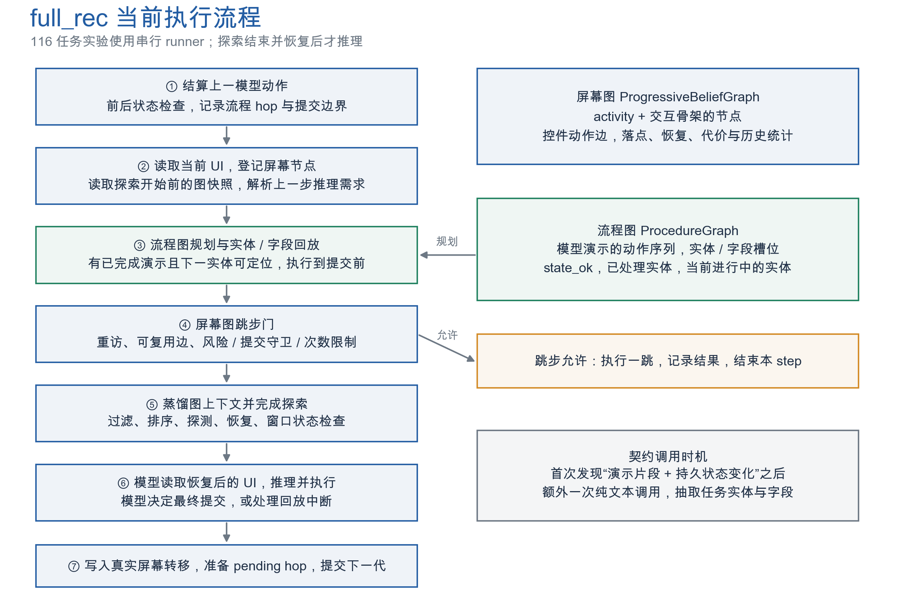
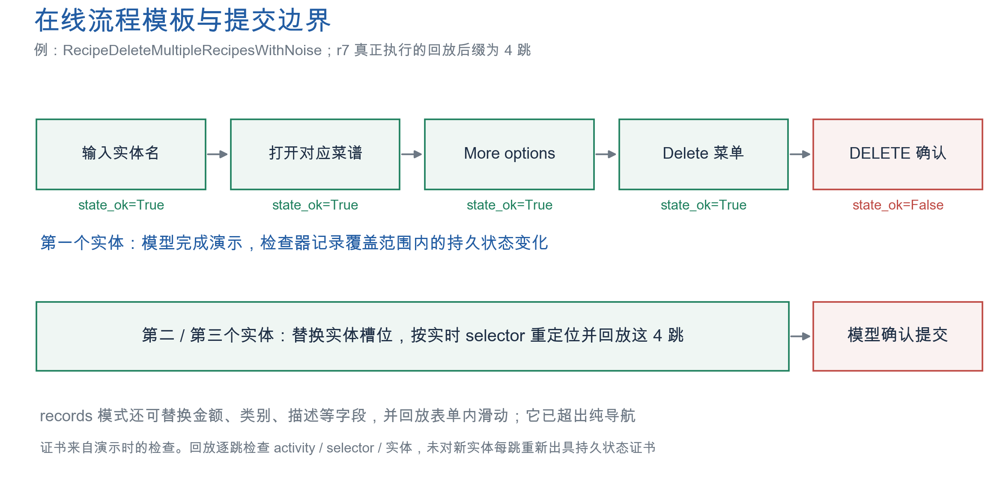
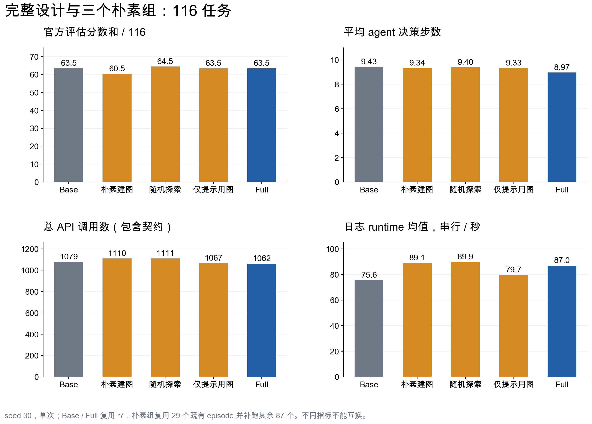
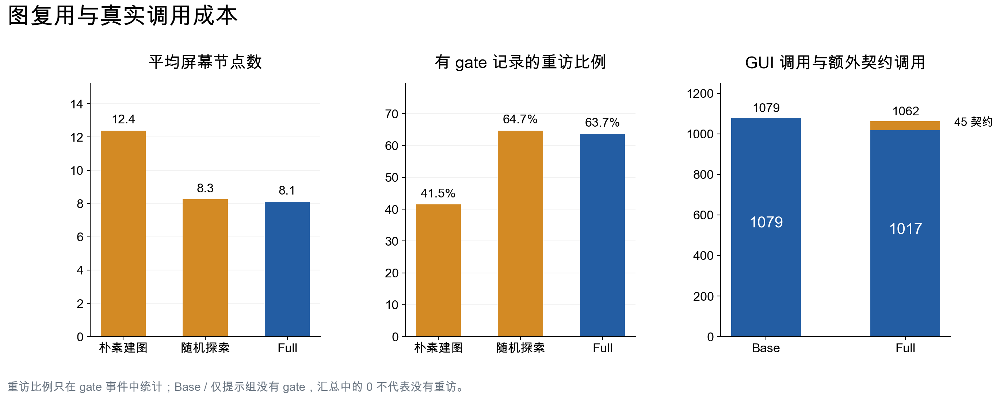
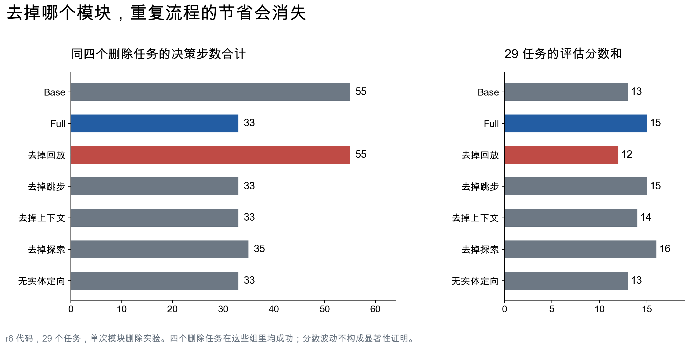

# MobileExplorer 最新代码流程与 PPT 讲解材料

核对日期：2026-10-06。来源：用户提供的《MobileExplorer 任务图证据.md》、当前工作区源码，以及已有实验目录。本文只读取实验，不启动模拟器、不改算法、不生成新实验数据。附带 PNG 可以直接放进 PPT，SVG 可以放大，CSV 可用于重建图表。

## 先确定讲解对象

报告里的完整设计是 **`full_rec`**，由 `scripts/run_task_navigation_pilot2.sh` 配置，主程序是 **`scripts/run_serial_exploration_task.py`**。它并不是上次新增的 `task_navigation execute` 分支。

```text
full_rec = 屏幕图 + 图矩阵探索 + 蒸馏上下文 + 旧图跳步
         + 流程图回放 + 任务实体 / 字段契约 + 独立 app 状态检查
         + 仅在可检查 app 探测 + 任务实体列表行放行
```

关键开关：`--probes_per_step 3 --max_depth 2 --enable_skip --graph_context distill --procedure_replay execute --state_checker on --procedure_records --probe_only_certifiable --probe_entity_rows`。当前最新代码还有 `--explore_handoff` 可选扩展，标准 full_rec 不打开它。旧 `task_navigation` 模块提供 frontier 排序函数，但该模块的 NAV_INTENT 路径执行器不是 full_rec 的主回放机制。

`run_one_parallel_exploration_task.py` 仍有上一轮 NAV_INTENT 导航实现，**尚未接入这里的 ProcedureGraph / records / AppStateChecker 完整调用链**。因此这批结果能用来讲机制，不能说是完整设计已在真实并行 runner 上验证。

## 1. 最新代码每一步怎样运行



1. **结算上一动作。** `finalize_procedure_hop()` 等画面稳定，比较上一模型动作前后的 app 状态，将该动作记录为 Hop。True 表示覆盖范围内持久状态不变，False 表示观察到变化，None 表示无覆盖或检查失败。
2. **登记当前页面。** 捕获 activity、a11y 控件树和屏幕签名，更新屏幕图节点。将上一次探测的前缀与模型实际落点对齐。默认 `align_promotes_current_step=true`，可以在本轮探索开始前刷新快照以消费该对齐；并非所有读取都机械地停留在上一轮末尾。
3. **尝试流程回放。** 找到完成过的单实体演示和下一个未处理实体，替换实体 / 字段槽位。逐跳重定位，执行、检查落点，停在模板最后一跳之后。模板不包含产生持久状态变化的提交动作。失败就从实际屏幕交还模型，当前实体锁阻止另一实体覆盖未提交表单。
4. **尝试旧图跳步。** 若有可复用边，检查风险、环、次数、已发现提交控件等门。允许时执行一跳，直接结束这个 agent.step，不调用模型。当前次数条件使 `max_path=3` 实际不能形成多跳：尝试须 `<2`，链式执行却要求已经尝试 `>=2`。
5. **准备图上下文与探测。** 从探索前快照取本页一跳事实，最多三条、约 64 个按空白分隔的词。满足 eligibility 才探测。串行实验先执行探测并恢复，再调用模型，本轮发现不能进入本轮图上下文。
6. **正常推理。** 模型读取恢复后的 GUI 和历史，决定下一动作。回放后的最终保存 / 删除确认仍由模型决策；它也负责处理模板失败和剩余判断。
7. **写回。** 模型真实转移更新屏幕图，准备下一步要结算的 pending Hop，提交图世代。回放实际操作另外写入恢复 prefix 和模型 summaries，不能假装这些操作没有发生。

源码入口：`run_serial_exploration_task.py:2937`。流程回放在 `:3396`，旧跳步在 `:3583`，探测门在 `:3807`，探索执行在 `:4037` 附近，模型调用在 `:4110` 附近。以函数名和条件为准，行号可能随后续修改变化。

## 2. 如何建图：身份、实例和任务流程分开

| 结构 | 保存什么 | 怎样增加 | 谁消费 |
|---|---|---|---|
| 屏幕图节点 | activity、交互骨架、控件清单、标签、访问数、严格签名、语义摘要 | 捕获真实页面或探测落点后 upsert | 探测排序、旧跳步、蒸馏 |
| 屏幕图边 | 源节点 + 控件动作，多个落点、恢复、执行 / 对齐统计、代价、风险 | 模型真实转移或 probe；前缀对齐可提升已探子边 | 同上 |
| 流程图 Hop | 实际动作、selector、内部标签、实体、字段、前后 activity、state_ok | 只从模型真实动作建立演示，下一步画面稳定后结算 | 模板提取和回放 |
| 任务覆盖 / 进度 | 实体顺序、每个实体的字段、done / failed / open_entity | 延迟契约调用、演示重新绑定、回放 / 提交后更新 | 回放选择、模型历史、探索目标 |

### 屏幕图为何能复用

节点身份：`hash(activity, layout_signature)`。交互骨架只看可交互控件的 class、resource ID、64px 网格位置；文字不进入身份，重复列表行只记录控件类型、不记录数量和位置，键盘 / 系统栏不进入骨架。因此删掉一条记录或改一个名字，不一定产生新节点。

边身份优先用 control_key 而非坐标，目的地是观测结果。**粗节点只负责检索，不代表 Alice 的数据可以给 Bob 使用。** 流程执行用任务实体和实时 selector 约束实例。

目前正常模型转移只有 `dst_id != src_id` 时才写屏幕图边；在同一页面填写字段等动作，常不会改变粗节点，因此其演示主要保存在流程 Hop，而不是屏幕图。这也是两种表示不能互相替代的原因。

source：`state.py:283`、`belief_graph.py:35`、`belief_graph.py:249`。

### 流程图如何形成模板

首次观察到“若干动作后出现持久状态变化”时，额外发一次纯文本模型调用。模型从任务原文提取实体和字段值，解析器只保留原文中出现的值，然后把已经记录的 Hop 重新绑定成槽位。**这与上一轮 NAV_INTENT 放进既有 THINK、不增加请求的方案不同。**

`template()` 从最近一次提交往前切到上一个边界。片段须只绑定一个实体，不能含无法替换的输入；不可认证跳在实体前可裁掉，在实体后则模板失效。records 模式最多保留 16 跳，普通模式最多 6 跳。



示例：第一个菜谱由模型完成“输入菜谱名、打开菜谱、More options、Delete 菜单、DELETE 确认”。前四跳持久状态不变，最后确认改数据。后两个菜谱回放前四跳，由模型按最终 DELETE。模板还可根据当前屏幕选更短后缀，省去已经完成的 Search 导航。

当前 records 模式会输入金额、描述、类别等字段，并可回放表单内滑动。PPT 应称 **实体 / 字段参数化流程回放**，不能称“只回放导航”或“所有编辑都交给模型”。只保证这个分支不自动执行模板终点的提交。

source：`procedure_replay.py:48`、`:327`、`:386`、`:608`；runner `:2854`、`:2874`。

## 3. 如何用图探索：先可恢复，再估计价值

主流程：

```text
eligibility → 静态候选过滤 → 状态图矩阵 → SafetyGate → 基础 scorer
            → 任务 frontier 加分 → 实际 probe → UI 恢复 → 窗口状态证书 → 写回图
```

**eligibility** 包含：step≥2、episode 预算未耗尽、节点至少访问两次、之前未恢复失败、app 可检查、无未保存输入、无日期 / 时间 / 数字选择器等。最多每步三次、深度二，episode 默认最多 12 次；auto 时间预算取已经观察到的推理耗时中位数。

**基本排序** 使用 `path_probability × expected_IG / expected_cost` 的启发式。估计依据是精确边历史、目的地、任务需求匹配、恢复和代价。新增元素数 / 10 是信息增益 proxy，没有校准概率或信息论保证。

**任务关联** 来自两个地方：上一模型输出解析出的 information need；流程契约里尚未处理的实体。`probe_entity_rows` 放行包含这些实体的列表行。frontier 对已见目标做最多四轮反向传播（每跳乘 0.8），加上目标标签覆盖和未知出口奖励，再按成本加到基础分数。它仍不是完整的“预计省多少模型调用”的路径补全算法。

状态检查器只验证明示覆盖范围内的 SQLite / 文件树 / shared_prefs。SQLite 每库使用一个只读事务，包含 WAL。普通 exploration 证书是**整个窗口前后**比较，不是给每个 probe 单独发证书；模型演示动作则逐动作括起来比较。网络、云端、其它 app 状态及未持久化输入不在该证书范围。

source：runner `:3807`、`:3885`；`live_probe.py:722`、`:1901`；`task_navigation.py:434`；`app_state_checker.py:1`。

## 4. 三个朴素实验究竟怎样实现

以 `scripts/run_task_navigation_pilot4.sh` 为配置真值，不把其名字理解为某篇论文的完整复现。

| 维度 | full_rec | naive_graph 朴素建图 | naive_explore 随机探索 | naive_use 仅提示用图 |
|---|---|---|---|---|
| 节点身份 | activity + 交互骨架 | activity + 严格实例签名，含文字和 16px 位置 | 同 Full | 同 Full |
| 边身份 | 控件动作，不按点坐标 | 原始 action，坐标进入 key | 同 Full | 同 Full |
| 流程重定位 | 每跳用实时 selector、实体和字段 | 规划后，按演示时 xy 回放，仍保留落点检查 | 同 Full | 无流程回放 |
| 探索基本策略 | 图矩阵、恢复 / 代价 / 任务加分 | 同 Full，但图更碎 | RandomRanker，用 seed+step shuffle | 同 Full 的图矩阵 |
| 实体列表行 | 尚未处理的任务实体可放行 | 保留 | 关闭放行 | 开关保留，但流程图关闭后没有契约实体 |
| 任务 frontier | 有契约后启用 | 保留 | 配置中可能生成目标，但随机分支直接返回、不用 frontier | 流程图关闭，没有契约目标 |
| 图对推理的作用 | 回放 + 旧跳步 + 蒸馏 | 同三条消费方式，但按坐标回放 | 同 Full | 只注入逐控件目的地文字，不跳步 |
| 状态检查 | 开启；只在可检查 app 探测 | 保留 | 保留 | 保留探索窗口检查 |

### A. naive_graph：实例建图 + 坐标执行

`ANDROID_WORLD_NAIVE_GRAPH=1` 同时改三处：`StateSignature.layout_sig` 返回严格 struct digest；`canonical_action()` 删除控件 key，哈希原始动作；回放 `execute()` 使用 Hop.xy，绕开实时 selector。它检验整个“稳定图身份和实时重定位”方案，**不是只改变节点 key 的单变量实验**。

严格节点多、重访减少，会影响探索资格和历史统计；坐标回放还可能点到另一行或另一类别。即使完成的回放跳数接近，也不能代表语义正确。

source：`state.py:69`、`belief_graph.py:52`、`procedure_replay.py:643`。

### B. naive_explore：随机顺序 + 取消实体行放行

脚本指定 `--exploration_policy random`，不传 `--probe_entity_rows`。runner 将 predictive_scorer 设为 False，选择 RandomRanker。它保留静态 `_safe_candidates`、可检查 app 门、时间 / 次数 / 恢复逻辑，但 `select_candidate()` 在 `not use_scorer` 中直接返回，因此也**绕过矩阵 SafetyGate 和 frontier**。

所以脚本注释中的“完全相同安全集合，只换随机排序”不完全准确。更干净的下一轮排序对照应保留同一个候选集和 SafetyGate，只在其之后随机排列；当前这组同时改变实体候选和评分路径。这里仅说明实现，不修改既有结果。

source：runner `:1787`、`:3876`；`rankers.py:64`；`live_probe.py:1927`。

### C. naive_use：图只进入文字 prompt

`--graph_context onclick --procedure_replay off`，不启用 `--enable_skip`。每次推理准备时从图检索本页控件事实，以可见标签关联目的地，模型仍然自己决定每一步。

该分支复用 GraphDistiller：仍做事实质量过滤、utility floor、三条 / 64词预算，并只输出正面事实。它并不把所有控件无条件注入，也不是 AutoDroid 官方方法的完整复现。没有正面可用事实时不注入。这组还失去流程契约驱动的探索目标，不能把全部差异归因于文字样式。

source：runner `:3951`；`graph_distiller.py:282`、`:339`。

### 可选 full_handoff

在 Full 上加 `--explore_handoff`。如果下一个实体不在屏幕上，而已回滚的 probe 曾揭示它，执行那次探测的定位动作后重新规划回放。这才建立更直接的 exploration→replay 连接。当前 116 任务对比没有该 arm；其收益不能写进 Full 的数字。

## 5. 最新数据如何放进 PPT

### 全量朴素组：116 任务

数据源：`results/sensys27_task_navigation/20261006_naive_full/`。已按最后一条同任务 ledger 记录去重，用 `pairs.jsonl` 重算，并核对各 episode 的 `api_calls.jsonl`。这是一套拼接结果：Base / Full 从 r7 复制；朴素组的 29 个既有 episode 复用，剩余 87 个补跑。单 seed、单次，不能称五组在一个新 session 全部交错配对。

| 组 | 评估分数和 / 116 | 平均决策步 | GUI API 调用 | 契约调用 | 总 API 调用 | 串行 runtime 均值 / 秒 |
|---|---:|---:|---:|---:|---:|---:|
| Base | 63.5 | 9.43 | 1079 | 0 | 1079 | 75.63 |
| Full | 63.5 | 8.97 | 1017 | 45 | 1062 | 87.00 |
| 朴素建图 | 60.5 | 9.34 | 1065 | 45 | 1110 | 89.12 |
| 随机探索 | 64.5 | 9.40 | 1067 | 44 | 1111 | 89.88 |
| 仅提示用图 | 63.5 | 9.33 | 1067 | 0 | 1067 | 79.73 |



Full 对同配置 Base：平均决策步减少 **4.94%**；GUI API 请求减少 **5.75%**；计入契约后总请求减少 **1.58%**；串行 runtime 增加 **15.03%**。这些百分比用精确原始数值计算。步骤是 agent decision count，不能当作实际 GUI 物理动作数。操作宏会在一次 agent.step 内执行多次 tap / input / drag。

53~54 个回放跳不是测得的“相对 Base 省了这么多 API 调用”：不同 arm 的后续路径、失败步、重试、契约开销都改变计数。r7 全部 API 日志更可靠地显示 `1079 GUI → 1017 GUI + 45 contract = 1062 total`。

Full 的探测次数 41，随机组 38；两组后来直接用于执行 / skip 的 probe 边均为 0。Full 回放 54 跳，随机也回放 54 跳。**现有证据没有证明任务导向探索优于随机。**



Full 每 episode 平均屏幕节点 8.11，朴素建图 12.39；有 gate 日志的重访比例约 63.65% 与 41.51%。这与碎片化减少一致，但属于各自实际轨迹的统计，不能独立隔离节点 key 因果。Base / 仅提示组的汇总 revisit_share=0 是缺少 gate 记录，不能当作“从不重访”。

### 模块删除：29 任务，r6 代码

这套不是上面的全量朴素组。它关闭 Full 的一个模块，回答“哪一部分是重复任务节省的必要条件”。



| 组 | 怎么关闭 | 同四个删除任务的步数和 | 29任务分数和 |
|---|---|---:|---:|
| Base | 不探测、不用图 | 55 | 13 |
| Full | 全部打开 | 33 | 15 |
| no_replay | procedure_replay off | 55 | 12 |
| no_skip | 不启用 enable_skip | 33 | 15 |
| no_context | graph_context off | 33 | 14 |
| no_explore | probes_per_step=0 | 35 | 16 |
| explore_untargeted | 不传实体行放行与只探可认证 app 两个门 | 33 | 13 |

四个删除任务在所有这些组里均成功。去掉回放，步数逐任务回到 10 / 13 / 13 / 19；其余模块关闭仍约 33~35。它支持**重复流程上的步数节省主要依赖流程回放**。29任务分数高低来自单次样本，不能宣称各模块有统计显著的成功率提升。

`no_replay` 也失去由流程动作识别出来的 commit_controls 和任务实体目标；`explore_untargeted` 同时去掉安全覆盖门。因此它们是系统层模块删除，不是完全解耦的数学单变量消融。

## 6. 汇报时应修正的表述

1. **“所有编辑都由模型做”不符合代码。** records 回放填写任务字段，最终持久提交交给模型。
2. **“一次无副作用演示证明以后安全”过强。** 证书覆盖演示时的状态，回放依据它许可新实体；执行器并未每跳重新调用持久状态 checker。仍需说明适用范围和可能的业务条件差异。
3. **“full_rec 输的任务都与图无关”过强。** 分叉早于主动图动作支持“不是直接错误回放导致”，但图记录、等待、checker 开销也能改变动画帧时序；仅凭截图首次分叉不能完全排除干预。可以展示归因线索，不称严格因果证明。
4. **“实现了完整 task-specific VOI 探索”不准确。** 当前是图统计加 task-label frontier heuristic；尚未显示相对随机的直接收益。
5. **“并行节省 wall-clock”未由这些数据建立。** 当前主证据来自串行 runner，runtime 反而更长。要补真正并行完整接线与包含 checker / settle / recovery 的端到端实验。
6. **“直接和 AutoDroid 公平比较”不准确。** naive_use 是同 backbone 下的本地提示策略对照，未复现官方离线构图与 agent 的整套方法。
7. **“屏幕图跳步每一条边都有严格无副作用证书”过强。** 旧 skip 使用 app 覆盖门和已见提交控件黑名单，不等于候选边逐一已认证；仍按旧坐标动作执行并做较宽松落点判定。不要把 ProcedureGraph 的证据门混同旧 skip。

## 7. 建议 8 页 PPT 顺序与讲稿

| 页 | 标题 | 图表 / 内容 | 一句话讲稿 |
|---|---|---|---|
| 1 | 当前设计与研究问题 | 三问、Full 模块、实验范围 | 当前系统同时记页面转移和实体流程，主要复用同任务内的演示。 |
| 2 | 每一步的执行流程 | 图 01 | 先尝试直接执行已演示流程，再尝试旧跳步，否则用图事实辅助模型。 |
| 3 | 屏幕身份与转移证据 | 两张图表、图 04 左两栏 | 页面骨架共享，实体和值在执行时重新绑定，避免把页面变化当成新 app 结构。 |
| 4 | 实体和字段流程回放 | 图 02 | 第一个实体提供示范，后续实体替换槽位，最终提交仍由模型决定。 |
| 5 | 图如何引导探索 | eligibility、SafetyGate、frontier 流程 | 当前探索只补可检查、可恢复区域，任务前沿尚未证明胜过随机。 |
| 6 | 三个朴素对照的实现 | 三组设计比较表 | 分别替换稳定身份 / 定位、探测策略、图的消费方式，说明实现中的联动。 |
| 7 | 全量结果与调用成本 | 图 03、图 04 右栏 | 决策步和 GUI 调用减少，但契约调用抵消部分收益，串行时间尚未改善。 |
| 8 | 回放贡献与下一步 | 图 05 | 四个重复删除任务的节省随回放关闭而消失；下一步重点验证探索解锁路径和真正并行收益。 |

适合最后一页的技术主张：**从当前任务的已完成演示中提取实体 / 字段流程，依据显式持久状态变化划分提交边界，在实时控件匹配下复用后续流程。** online exploration 目前是受约束的辅助机制；若要坚持它是主贡献，需要新增可解锁路径和相对随机的证据。

## 图表文件

- `01_algorithm_flow.png/.svg`：当前串行 Full 流程。
- `02_procedure_boundary.png/.svg`：实体槽位和提交边界。
- `03_naive_comparison_116.png/.svg`：五组全量结果和串行时间。
- `04_graph_and_calls.png/.svg`：节点、重访和 GUI / contract 调用分解。
- `05_module_ablation_29.png/.svg`：模块删除与四任务步数。
- `verified_metrics.csv/.json`、`module_ablation_29.csv`：重新核对的作图数据。
- `build_figures.py`：只读已有日志的可复现绘图脚本。
