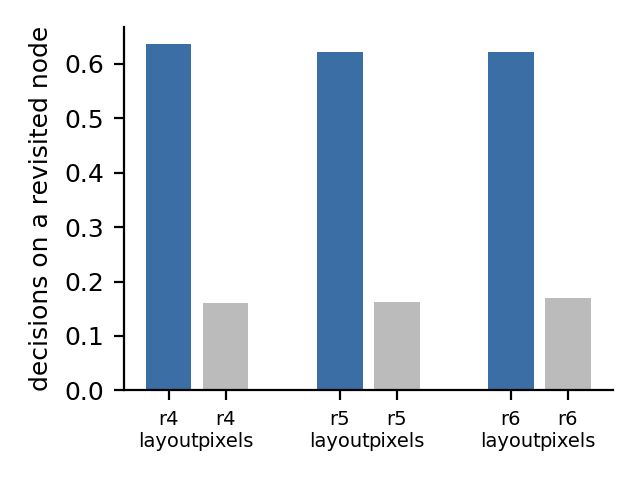
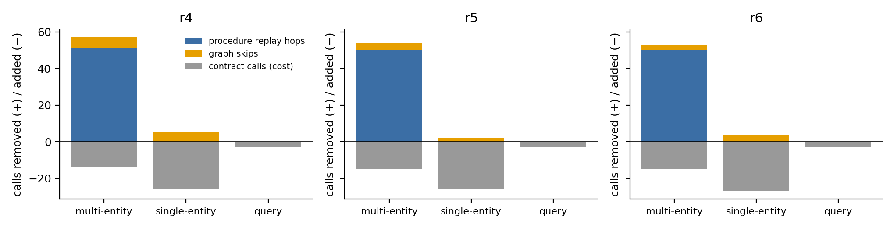
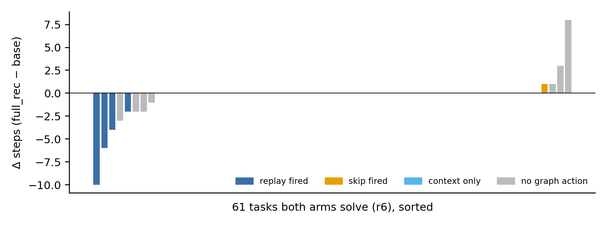

# MobileExplorer 完整设计 v3：在线任务图的建图、检索、探索与推理

日期：2026-10-04。v3 = 原设计（推理窗口内的并行探索 + 渐进式 belief graph + 图跳过 + 蒸馏图上下文，即 v29 配置）+ v2 的任务实体参数化流程图，并让两者共用一套节点匹配与证据。代码位置都写在对应小节里。实测在第 6 节（`results/sensys27_task_navigation/20261004_full_r4/`，复现实验 `20261004_full_r5/`）。

---

## 1. 如何建图（问题一）

### 1.1 节点：屏幕的三层签名

同一块屏幕在不同时刻有三种“相同”的含义，所以节点身份分三层，各司其职（`android_world/parallel_exploration/state.py`）：

| 签名 | 计算方式 | 用途 | 为什么不用其他两层 |
|---|---|---|---|
| **layout_sig**（节点键） | 只取**可交互**控件（clickable / scrollable / checkable）的 `(class, resource_id, 64px 网格位置)` 排序后取 SHA-256 前 20 位；**文字完全不参与**；同类控件出现多次（列表行）时只保留类别、不保留位置；键盘、状态栏等 overlay 包排除 | 图节点 ID：`node_id = H(activity, layout_sig)`；“我以前来过这类屏幕吗” | 文字和像素一变就成新节点：曾经一个 Activity 被切成 40 个节点，渐进记忆永远攒不出重访 |
| **struct_sig**（精确实例） | 所有元素的 `(class, resource_id, text, selected, 16px 网格 bounds)` 的 SHA-256 | 回滚验证、回放落点验证：“是不是我离开时的那个状态” | 太严，不能做节点键；但做实例校验正合适 |
| **phash**（视觉） | 32×32 灰度 DCT 取 8×8 低频，与中位数比较得 64 位哈希 | 汉明距离 ≤ 12 视为同屏，辅助回滚 | 只做辅助 |

列表行做“只计类别”的处理，是为了让“3 行的列表”和“4 行的列表”落在同一个节点上。否则重复任务每做一轮就会生成一个新节点，上一轮走过的边再也认不出来。

### 1.2 边：控件，而不是坐标

边的身份是 `(src_node, action_type, control_key)`，**不含目的地**；目的地作为观测结果统计在边上（`observed_destinations`）。`control_key` 取点击点处**最小的包含元素**的 `resource_id | text | content_desc | class`。模型每次点的坐标会有抖动，但控件是稳定的。无名控件退化为“类别 + 自身中心的 96px 网格”。边上累积的证据：

- 执行与探测计数（`execution_hit/miss`、`probe_count`、回滚成功与失败）；
- 状态（`SPECULATIVE → INFERENCE_ALIGNED → REUSABLE`，以及 `INVALID/STALE`）；
- 新出现的标签（`discovered_labels`，只记相对源屏幕**新增**的标签，否则会把 app 自己的工具栏当成证据）；
- 世代号（`last_updated_generation`）：第 t 步探索写入的证据，只有第 t+1 步及以后才能读到（`GenerationGuardedGraph`），保证和并行设计的时序一致。

### 1.3 v2 新增：任务实体参数化的流程层（`procedure_replay.py`）

模型真实执行的每一跳，都额外记录：控件的 resource_id 和 class、**自身标签与内部标签**（落在控件 bounds 内的所有子节点文字）、动作类型（click / long_press / input_text），以及**独立状态检查器**给出的持久状态判定（`app_state_checker.py`：SQLite 逐表逻辑哈希、文件树与文件 md5、shared_prefs；动作前后各拍一次快照）。

当图里第一次出现“若干跳之后接一次改持久状态的提交”时，用一次纯文本模型调用抽出任务实体（约 105 个 token，只保留在目标原文里逐字出现的实体）。随后把实体回绑到已有的跳上：被按控件的内部标签恰好包含某个实体，或者输入的文字正好等于某个实体，这一跳就成为**槽位**。

**和离线 UTG、app 文档、跨任务记忆的区别**：每个 episode 都从空图开始；证据来自本次任务里模型自己的执行和本次探索；槽位绑定的是本任务目标里的实体。不需要预先探索 app，也不需要别的任务的轨迹。

### 1.4 记录槽位（`--procedure_records`）

对“新增多个条目”这类任务，每个条目除了名称，还有一组字段（金额、类别、备注……）。任务契约改为返回结构化记录：`{"items":[{"name":…, "fields":{"amount":…, "category":…}}]}`，每个值都必须在目标原文里逐字出现。随后做规范化：“Expense: Legal Fees”取冒号后的名称；“$10.14”去掉开头的货币符号。规范化的依据是模型实际输入的形式。

取模板时先确定这段演示对应的实体 e，再逐跳判断：

- 输入的文字等于 e 的某个字段值，这一跳就是**字段槽位**；
- 点击的选项标签等于 e 的某个字段值（比如类别 “Social”），这一跳也是字段槽位；
- 输入的文字既不是实体、也不是字段值（比如笔记正文），模板作废，因为这段内容无法替另一个实体回放。

回放第二个条目时，字段槽位填入它自己的值：输入框按 resource_id 和 class 唯一定位后先清空再输入；选项按“标签等于新值”唯一定位。提交（保存）仍然由模型完成。

### 1.5 节点匹配的实测读数（full_r3，26 个任务）

| 读数 | 值 | 含义 |
|---|---|---|
| 决策时站在本 episode 已访问节点上的步骤（按 layout_sig） | **155/244 = 64%** | 宽松节点键让证据能被后续步骤复用 |
| 同一统计按严格签名（struct_sig） | 约 5% | 若用严格签名做节点键，图几乎无法复用 |
| 记录的执行跳 / 其中检查器证实不改状态 / 证实改了状态 | 182 / 65 / 17 | 后两类分别是可回放导航与必须由模型决定的提交 |

---

## 2. 如何查询图、如何把图节点匹配到当前页面

### 2.1 匹配

每一步截屏后计算 `layout_sig`，查 `node_id = H(activity, layout_sig)`：

- **命中**：说明是重访。拿到该节点的出边、访问次数、描述。
- **未命中**：新建节点。

节点匹配只是“检索键”，**不能作为执行许可**。任何真正要执行的动作（图跳过、流程回放）都要在当前屏幕上重新定位控件：

- 图跳过按 `control_key` 定位；
- 流程回放按“resource_id + class + 自身或内部标签”定位，并要求在当前屏幕上**唯一**、完全落在屏幕内（排除转场动画中滑入的控件）；
- 输入框按 `resource_id + class` 唯一定位；
- 实体行按“相同 resource_id 和 class，且内部标签恰好包含该实体”唯一定位；出现多个就拒绝。

### 2.2 查询

所有读操作都基于上一世代的快照，有三种查询：

1. **局部一跳查询**（distiller）：当前节点的出边。
2. **重访查询**（图跳过）：当前节点上是否存在 `REUSABLE` 边、可否回放。
3. **流程查询**（v2）：最近一次“上一次提交之后 → 下一次提交之前”的完整演示。按任务顺序取下一个未完成的实体，在模板里从后往前找**最晚的可行起点**：实体已经作为模板的实体按压出现在屏幕上，就从这一跳开始；否则从“输入框或搜索按钮还在屏幕上、且实体会被输入”的那一跳开始。

---

## 3. 如何用图增强 exploration（问题二）

探索仍然是原设计的结构：模型推理期间，在推理窗口里对当前屏幕做最多 3 个 probe、深度 2，每个 probe 后按恢复阶梯回滚（`live_probe.py`）。候选先过 SafetyGate（危险控件、编辑框、设置页等），再由 `PredictiveElementScorer` 按“路径概率 × 期望信息增益 / 代价”排序。

v3 改动的是**探索目标**。流程图持有任务契约以后，探索的目标标签被设为**尚未处理的任务实体**（按任务顺序）。frontier 打分在原排序上加一项：

```
score(candidate) = direct_coverage + downstream_coverage + 0.25 · unknown_bonus
direct_coverage     = |目标实体 ∩ 候选控件的自身标签与内部标签| / |目标实体|
downstream_coverage = 0.8^k 衰减地沿图反向传播：k 跳之内能到达含有目标实体标签的节点
unknown_bonus       = 1 / (1 + 该控件已被探测次数)
```

已知无效的控件（自环）直接剔除。效果是让 probe 优先去打开下一个实体那一行，或者去打开通向它的入口。这一步既能确认实体的位置，又能在状态检查器的监视下预先验证这一跳不改数据。图里还没有任务契约时（演示还没完成），沿用原设计的排序。

**两条约束（来自 full_r3 的问题清单）**：

- **只在可验证的 app 里探测**（`--probe_only_certifiable`）。探测只在状态检查器覆盖的 app 里进行。无法验证探测有没有副作用的 app（比如 Files），即使界面能恢复也不探测。在 r3 里，Files 上两次探测分别造成回滚失败和 app 被带回桌面，两个任务都因此失败。
- **任务实体行可探测**（`--probe_entity_rows`）。安全门默认把重复出现的列表行当作“动态列表项”过滤，原因是随便探一行信息量低、风险高。在 r3 里这条规则过滤了 584 次，66 个探索窗口中有 51 个一次 probe 也没完成，而任务实体恰好都在列表行里。现在，候选增强生成的“带标签副本”如果标签恰好是还没处理的任务实体，就不受这条规则过滤；其余安全规则照常生效。

**回滚的正确性**（`live_probe._replay_record`）。深度 2 的探测在回滚时需要先重建父状态，即重放“已提交动作 + 父 probe”。父 probe 是滑动时，原实现把它记成了点击，重放时点到了日历控件的中间，选中了另一天；随后外层回滚又用探测前的旧截图做比较，把被改过的屏幕判成“无变化”（SimpleCalendarAddOneEventRelativeDay，r4）。现在重放按真实动作（滑动）记录；嵌套回滚失败后，外层回滚用重新截取的屏幕做比较。

缺口分三类，探索只花在前两类上：

| 缺口 | 定义 | 探索怎么补 |
|---|---|---|
| G1 证书缺口 | 模板里有跳还没拿到状态证书 | probe 这一跳并恢复，期间由检查器监视 |
| G2 定位缺口 | 下一个实体不在当前屏幕上 | frontier 引导 probe 去找；模板自带搜索子流程时，直接回放搜索 |
| G3 演示缺口 | 还没有完成的演示 | 不专门探索，第一个实体由模型自己完成 |

---

## 4. 如何用图增强 reasoning（问题三）

每一步推理之前，按下面的顺序决定这一步怎么用图（`graph_distiller.ReasoningGate` 以及 runner 里的流程回放）：

1. **流程回放**（v2）：模板就绪，并且下一个实体可以定位，就逐跳回放导航部分，每跳校验落点（activity；实体跳还要校验新实体出现在落点上），**停在模板终点**，也就是演示里第一个改持久状态的跳之前。回放的每一步都写进模型历史；模型完成提交后，再追加一条事实性的进度记录（已处理哪些、还剩哪些）。回放失败的实体不标为完成，也不自动重试。**进行中条目锁**：回放一旦对某个实体执行了动作，在检查器观测到一次提交之前，不再为任何实体规划新的回放。来源：ExpenseAddMultiple 中 Legal Fees 的回放在类别选项处停下，下一步规划器就开始回放 Stationery，把还没保存的 Legal Fees 表单覆盖了（Expense 的所有页面属于同一个 Activity，任何屏幕都能匹配模板起点）。
2. **图跳过**（原设计）：当前节点有 `REUSABLE` 边，且满足连续跳过不超过 3 次、目的地不构成最近的环等条件，就直接执行这条边、省掉这一步推理。v3 加了**提交守卫**：候选路径一旦走到检查器判定为“会改持久状态”的控件（DELETE、SAVE、CONFIRM），就在它之前截断。这条规则来自实测：流程回放刚刚停在 DELETE 之前，图跳过就因为模型按过两次 DELETE，而替模型按了下去。这样，“提交一定由模型决定”同时约束了流程回放和图跳过两条路径。
3. **图增强推理**（原设计，distill）：其余情况下，把当前节点的出边蒸馏成最多 3 条、约 64 token 的事实，追加到 prompt 里：
   - **检索**：只取当前节点的一跳出边；
   - **过滤**：去掉 `INVALID/STALE` 边，以及只能用坐标描述的控件；
   - **打分**：`utility = (0.25 + need_match) × certainty_weight × (0.5 + 0.5 × 历史成功率) × e^{-age/6}`，其中 `need_match` 是信息需求词和边上标签的重叠率；已经做过的边固定给 `0.4 × freshness`，用来阻止重复操作；
   - **压缩**：取 utility ≥ 0.15 的前 3 条；
   - **模板**：只陈述观测，不给建议（例如 "Verified: X → {…}"、"Already used: X"）；不做没有覆盖证据支撑的否定断言。
4. **正常推理**。

复杂判断（提交、确认、编辑文本、作答、COMPLETE）只出现在第 4 种情况，或者第 1 种情况的终点之后，一定由模型自己决定。

---

## 5. 复现性措施（两组共用）

- vLLM 关闭 prefix cache 和多模态缓存（`--seed 0`），每个请求带唯一的 `cache_salt`。实测：输入相同时，输出逐字节一致。
- SystemUI 演示模式：固定时钟、电量、信号。
- 截图稳定判定：连续 3 帧（跨 0.7 秒）完全相同才使用；只有光标那一小块区域在闪时，取三帧的逐像素最大值合成一张图。
- 滑动保持与 4B_2 相同的 500 ms fling。曾试过“分步拖动、停顿后松手”的无惯性滑动，但每次 `input` 都是独立 JVM，按下与移动之间的间隔被识别为长按，列表滚动失效（ExpenseDeleteMultiple2 由成功变成 21 步失败），已撤回。
- 这些措施改变了截图时机，所以 **4B_2 只作历史参考**；base 和 full_rec 两组共享全部设置，同一 session 内逐任务交错配对。
- 剩余的不确定性来自环境时序：动画进行到哪一帧、任务初始化后的屏幕。第 6.4 节的失败分析表明，full_rec 输给 base 的任务全部是这种分叉。

## 6. 实测

运行目录：`results/sensys27_task_navigation/20261004_full_r4/`。116 个任务，seed 30，GELab-Zero-4B，步数上限 20。每个任务先跑 base、再跑 full_rec，同一 session 内交错配对。

- **base**：v29 的提示词与启动折叠，不探索、不用图。
- **full_rec**：v29 原设计（3 个 probe、深度 2、图跳过、distill 图上下文）+ 流程图（`--procedure_replay execute --procedure_records`）+ 状态检查器，外加 `--probe_only_certifiable --probe_entity_rows`。

结果文件：

- `pairs.jsonl`：逐任务记录；
- `final_compare_full_rec.json`：汇总对比；
- `full_rec_explain.json`：Q1–Q3 读数；
- `full_rec_traces/<task>.md`：每一步走了哪条图路径、为什么；
- `code_changes.txt`：运行中的每次代码修改及对应的补跑；
- `../20261004_full_r3/ISSUES.md`：问题清单 1–8。

**结果全部来自同一份最终代码。** 运行中修过的问题在 ISSUES #6–#8。full_rec 中凡是开跑时间早于最后一次修复的 episode（68 个），以及一个评估器报"短信发不出去"的环境故障 episode，都已移到 `_superseded/`，并用最终代码重跑。"进行中条目锁"只在发生过回放的 episode 里起作用，因此加锁之后又单独重跑了 ExpenseAddMultiple。base 的代码路径没有变化，直接复用。

### 6.1 主结果（116 个任务）

| 组 | 成功（分数和） | 成功率 | 平均步数 | 成功任务的平均步数 |
|---|---|---|---|---|
| 4B_2（历史基线） | 54 | 46.6% | 10.83 | 7.85 |
| base（同 session） | 63 | 54.3% | 9.45 | 7.22 |
| **full_rec** | **60** | **51.7%** | **9.33** | **6.93** |

- **对 4B_2**：成功多 6 个（full_rec 独有成功 12 个，4B_2 独有成功 6 个），平均步数少 13.9%，成功任务步数少 11.7%。两边都成功的 48 个任务上，步数从 7.96 降到 6.27（−21%）。三项目标都达到了。
- **对 base**：成功少 3 个，在同配置重复实验 ±8–10 的波动范围之内。平均步数 9.45 → 9.33。两边都成功的 58 个任务上，6.76 → 6.66。GUI 推理调用从 1083 次降到 1054 次（−2.7%），另有 43 次纯文本的任务契约调用。

### 6.2 节省出在哪里：流程回放（问题三的主要来源）

| 任务 | base | full_rec | 回放（实体：完成跳数/计划跳数，停止原因） |
|---|---|---|---|
| ExpenseDeleteMultiple | 成功 / 10 步 | 成功 / **6** 步 | Flight Tickets 2/2、Taxi Fare 2/2，都停在提交前 |
| ExpenseDeleteMultiple2 | 成功 / 13 | 成功 / **11** | Unexpected Expenses 2/2 |
| RecipeDeleteMultipleRecipes | 成功 / 13 | 成功 / **7** | 2 个实体各 3/3 |
| RecipeDeleteMultipleRecipesWithNoise | 成功 / 19 | 成功 / **9** | 2 个实体各 4/4 |
| RecipeAddMultipleRecipes | 失败 / 21 | **成功** / 21 | 2 个实体各 11/11（字段槽位：名称、描述、份量、时间……） |
| ExpenseAddMultiple | 失败 / 21 | 失败 / 18 | 2 个实体各 4/6，停在类别选项（选项在屏幕外，定位不到） |
| MarkorMergeNotes | 失败 / 21 | 失败 / 21 | 1/9，定位不到 |

- 4 个多实体删除任务两边都成功，步数合计从 55 降到 33（−40%）。
- 一个新增多条目的任务因为回放才能在 20 步内做完。
- 12 次回放中：
  - 9 次正常停在提交前；
  - 3 次因定位不到控件而交还给模型，交还后没有覆盖、也没有误报完成。
- 回放从来不替模型提交：每个停在提交前的实体，保存或删除都由模型自己按下。

### 6.3 可解释读数（`full_rec_explain.json`）

**问题一：怎么建图、图有多少可复用的东西。**

- **节点与边**：1082 个决策步共建出 969 个节点、569 条边。
- **重访**：决策时站在本 episode 已访问过的节点上的步骤占 **688/1082 = 64%**，与 r3 的 64% 一致。这是节点键用 layout_sig（不含文字、列表行只计类别）的直接结果；按严格签名统计只有约 5%。
- **执行跳**：记录了 901 个执行跳。检查器证实其中 425 个不改持久状态，这些是可回放的导航；证实 82 个改了状态，这些是提交，只能由模型来按。
- **任务契约**：39 个任务触发了任务契约调用，也就是演示已经完成、值得抽取实体的任务。

**问题二：图怎样增强探索。**

| | 检查器覆盖的 app（64 个任务） | 未覆盖（52 个任务） |
|---|---|---|
| 探索轮数 / 完成的 probe | 96 / 40 | 0 / 0 |
| 以任务实体为目标的轮数 | 8 | — |

“只在可验证的 app 里探测”把探索限制在 64 个任务上；未覆盖的 52 个任务里没有一次探测，也就不再出现 r3 那种回滚失败。

探索的贡献仍然很小：只完成了 40 个 probe，以实体为目标的轮数只有 8，只命中 1 个候选。原因有两个：

- 大多数成功都是短 episode，探索窗口和实体目标都还没准备好，任务就结束了（见记忆 project_graph_arrives_too_late）。
- 多实体任务里，实体行已经在屏幕上，回放可以直接定位，不需要先探测。

所以本设计的节省主要来自"执行时记录 + 回放"，探索的作用是：

1. 在不改数据的前提下为模板跳补齐证书（G1）；
2. 找到不在屏幕上的实体（G2）。

这一点要如实写进论文。

**问题三：图怎样增强推理。** 每一步走哪条路径（来自 `full_rec_traces/`）：

| 路径 | 步数 | 说明 |
|---|---|---|
| 正常推理 | 1048 | |
| 流程回放 | 12 次，共执行 51 跳 | 见 6.2 |
| 图跳过 | 11 次，落点正确 10 次（91%） | 另有 9 次候选被提交守卫截断、492 次因 app 不可验证而交还给模型 |
| 图上下文注入 | 11 步 | distill 后每次最多 3 条、约 64 token |
| 启动折叠 | 97 个 episode | 第一步打开 app 不需要推理 |

图跳过只出现在重访多的长 episode 里，比如 ExpenseDeleteDuplicates2 和 RecipeDeleteDuplicateRecipes3 两组都失败。这和“图要靠重访才有材料”的结论一致，所以本设计把主力放在不依赖重访的流程回放上：第一个实体演示完，第二个实体就能用。

### 6.4 full_rec 输给 base 的 5 个任务

| 任务 | 机制在分叉前是否有动作 | 分叉点 |
|---|---|---|
| SystemBrightnessMin | 无。设置 app 不可验证，10 步图跳过全部交还模型 | 第 0 步截图就不同（初始状态不同） |
| BrowserMaze | 无。20 步全部交还 | 迷宫任务本身波动大，旧代码的 full_rec 在这个任务上同样失败 |
| FilesDeleteFile | 无 | 第 2 步截图不同（时序） |
| MarkorEditNote | 无（只有启动折叠） | 第 2 步截图不同：编辑区光标和键盘出现的时机不同 |
| SimpleCalendarAddOneEventRelativeDay | 无。第一次探索在第 8 步 | 第 3 步截图不同 |

5 个任务都是在图机制采取任何动作之前就已分叉，分叉来自环境时序。依据是：两组的模型输入一旦相同，输出就逐字节一致（`api_calls.jsonl` 里的 image_md5 和 output_md5）。full_rec 赢 base 的 2 个任务里，RecipeAddMultipleRecipes 是回放带来的；ExpenseAddSingle 没有回放，同样是时序分叉。

### 6.5 复现实验（r5）与新发现的两个机制问题

`results/sensys27_task_navigation/20261004_full_r5/`：代码冻结（快照在目录内），整套 base + full_rec 配对重跑一次。

| 组 | 成功（分数和） | 平均步数 | 成功任务步数 |
|---|---|---|---|
| 4B_2 | 54 | 10.83 | 7.85 |
| base | 63.5 | 9.28 | 6.84 |
| **full_rec** | **60.5** | **8.91** | **6.77** |

- **对 4B_2**：三项目标再次全部达到。两边都成功的 48 个任务上，步数从 7.96 降到 6.08。
- **对 base**：full_rec 少 3 分，与 r4 相同。GUI 推理调用 1060 → 1055。
- **回放节省逐任务复现**，步数与 r4 完全相同：
  - ExpenseDeleteMultiple：10 → 6
  - ExpenseDeleteMultiple2：13 → 11
  - RecipeDeleteMultipleRecipes：13 → 7
  - RecipeDeleteMultipleRecipesWithNoise：19 → 9
- **机制读数稳定**：
  - 重访占比：643/1033 = 62%（r4 为 64%）；
  - 回放：11 次、50 跳（r4 为 12 次、51 跳）；
  - 图跳过：6 次、全部落点正确；
  - 探索：91 轮、36 个 probe。

r5 中 full_rec 输给 base 的 5 个任务里，4 个在图机制采取任何动作之前就已分叉（环境时序或 fling 惯性）。另有两个任务确实是机制造成的失败，两者都出在**探索的回滚**上：

1. **SimpleCalendarAddOneEventRelativeDay**：两组前 8 步的输入输出逐字节一致。
   - 第 8 步的深度 2 probe 在日期选择器里点了"10"号，标题从 Thu, Oct 19 变成了 Tue, Oct 10。
   - 回滚校验比较的是类别、id、16px 网格位置、可点击和选中状态，**不比较文字**，所以判定为恢复成功。
   - 模型随后按 OK，事件被建在错误的日期上。
   - 修复：日期、时间、数字选择器本质上是输入控件，和编辑框一样，屏幕上出现选择器时不探测。
2. **RecipeAddMultipleRecipes**（base 也失败）：前 16 步与 r4 一致，3 个菜谱都已保存。
   - 第 17 步的 probe 回滚降级到"轨迹重放"：从桌面把本 episode 的动作全部重放一遍，其中包括第一个菜谱已经持久化的录入。
   - 输入超时后，屏幕停在一个半填的重复表单上；模型按下 SAVE，产生了重复记录。
   - 修复：检查器观测到过提交后，不再允许跨提交的轨迹重放，因为这种重放不是幂等的。

这两条修复记为 ISSUES #9、#10。r4 中 SimpleCalendarAddOneEventRelativeDay 的那次失败确实是第 3 步的时序分叉；r5 则说明，即使没有时序分叉，这个任务也会被选择器探测弄坏。

### 6.6 修复验证（r6，最终配置）

`results/sensys27_task_navigation/20261004_full_r6/`：r5 代码加上 ISSUES #9、#10，整套重新配对运行，运行期间不改代码。

| 组 | 成功（分数和） | 成功率 | 平均步数 | 成功任务的平均步数 |
|---|---|---|---|---|
| 4B_2 | 54 | 46.6% | 10.83 | 7.85 |
| base（同 session） | 61.5 | 53.0% | 9.38 | 6.77 |
| **full_rec（最终）** | **64.5** | **55.6%** | **8.95** | **7.06** |

- **对 4B_2**：
  - 成功多 10.5 分（full_rec 独有成功 17 个，4B_2 独有成功 6 个）；
  - 平均步数少 17%，成功任务步数少 10%；
  - 两边都成功的 48 个任务上，步数从 7.96 降到 6.10（−23%）。
- **对 base**：
  - 成功多 3 分：full_rec 赢 4 个任务，只输 1 个（ClockStopWatchPausedVerify，时钟 app 不可验证，图机制没有动作）；
  - 两边都成功的 61 个任务上，步数从 6.85 降到 6.57；
  - GUI 推理调用 1072 → 1061。
  - full_rec 自己的"成功任务步数"（7.06）高于 base（6.77），原因是它多做成了 RecipeAddMultipleRecipes 这类长任务（21 步）。只看两边都成功的任务，步数仍然更少。
- **修复 #9 起作用**：RecipeAddMultipleRecipes 在 r5 因跨提交的轨迹重放失败；r6 中同一步的深度 2 回滚失败后，不再重放，外层用反向滑动恢复，任务成功。
- **修复 #10 起作用**：SimpleCalendarAddOneEventRelativeDay 在 r6 中一次探测也没有发生，两组都成功（17 步）。

**三次完整运行汇总**（116 个任务，每次都是同 session 配对）：

| 运行 | 4B_2 | base | full_rec | full_rec 平均步数（4B_2 = 10.83） | 两边都成功时 full_rec 对 4B_2 的步数 |
|---|---|---|---|---|---|
| r4（最终代码补跑） | 54 | 63 | 60 | 9.33 | 7.96 → 6.27 |
| r5（冻结复现） | 54 | 63.5 | 60.5 | 8.91 | 7.96 → 6.08 |
| r6（+#9 #10） | 54 | 61.5 | **64.5** | 8.95 | 7.96 → 6.10 |

**r6 的可解释读数**：

- **问题一（建图）**：
  - 1038 步建出 964 个节点、556 条边；
  - 重访占比 646/1038 = 62%；
  - 874 个执行跳中，411 个经检查器证实不改状态（可回放），78 个是提交。
- **问题二（探索）**：
  - 探索只发生在检查器覆盖的 64 个任务上，共 70 轮、34 个 probe；52 个不可验证的任务没有一次探测；
  - 选择器屏幕和发生过提交之后的轨迹重放已被排除，r6 没有出现任何回滚造成的失败。
- **问题三（推理）**：
  - 回放 11 次、共 50 跳，其中 9 次停在提交前、2 次因定位不到控件交还给模型；
  - 图跳过 7 次，其中 5 次落点正确；
  - 提交守卫截断 8 次，不可验证的 app 里交还模型 473 次；
  - 图上下文注入 9 步。

**还没解决的问题**：

- ExpenseAddMultiple 的类别选项在横向列表的屏幕外，回放定位不到，三次都在同一跳停下（下一步：在选项容器内滑动后再定位）。
- 探索对结果的贡献仍然很小，节省主要来自流程回放。

---

## 7. 模块可解释性

目的：把 full_rec 的效果拆到各个模块上，回答“每个模块到底贡献了多少”。分两部分：

- **离线**（本节 7.1–7.5，已完成）：只读 r4/r5/r6 已有日志，不占模拟器。
  - 分析脚本：`scripts/explain_modules_offline.py`，输出 `<run>/modules_offline.json`；
  - 作图脚本：`scripts/plot_modules_offline.py`，图在 `docs/figures/modules/`。
- **在线消融**（7.6，运行中）：`scripts/run_task_navigation_pilot3.sh`。每组都是 full_rec 只去掉一个模块。

判断以机制读数为主。同配置重复实验的成功数波动有 ±8–10，单看成功率区分不了模块。

### 7.1 图：节点键决定图里有多少可复用的材料

| | r4 | r5 | r6 |
|---|---|---|---|
| 决策时位于已访问节点（layout_sig 节点键） | 688/1082 = **64%** | 643/1033 = **62%** | 646/1038 = **62%** |
| 决策时模型输入截图与本 episode 此前某次完全相同 | 16% | 16% | 17% |
| 对照：base 组的同一指标 | 16% | 15% | 17% |



- 如果按截图逐像素做节点键，只有约 16% 的决策站在旧节点上；layout_sig 把这个比例提高到约 4 倍。
- base 和 full_rec 的“截图完全相同”比例一样，说明 full_rec 没有因为探测而多绕回头路。重访来自任务本身：回到列表、反复打开同一个表单。
- 结构签名、感知哈希、activity 三种键需要逐步记录签名，旧日志里没有；在线阶段之后补记录再比较。

### 7.2 每个模块的贡献

| 模块 | 触发（r4 / r5 / r6） | 省掉的 GUI 推理 | 对步数的配对影响（两组都成功的任务） | 对成功的影响 |
|---|---|---|---|---|
| 流程回放 | 12 / 11 / 11 次 | **51 / 50 / 50 跳** | 每次运行都是同样 4 个任务，各 **−5.5 步**，逐任务相同 | RecipeAddMultipleRecipes 在 r4、r6 因回放成功 |
| 图跳过 | 11 / 6 / 7 次，落点正确 10 / 6 / 5 | 11 / 6 / 7 | 两组都成功的任务上至多触发 1 次（+1 步） | 无 |
| 图上下文注入 | 11 / 8 / 9 步 | 0 | 2 个任务，0 步 | 无 |
| 探索 | 96 / 91 / 70 轮；40 / 36 / 34 个 probe | 0（直接） | — | 回滚失败 4 / 3 / 2 次；r5 有 2 个失败由它造成，r6 修复后为 0 |
| 任务契约调用（成本） | 43 / 44 / 45 次纯文本调用 | 每次运行约 −44 | 约 136 prompt token/次 | — |
| 启动折叠 | base 与 full_rec 都有（97/116） | 两组相同 | 不计入 full_rec 的贡献 | — |

其余两组都成功的任务（没有回放触发）上，配对步数差分别为 +0.29 / +0.11 / +0.07，即没有差别。





结论：

1. **步数的节省几乎全部来自流程回放**，集中在多实体任务上：每次运行都是同样 4 个任务，合计少 22 步，三次运行逐任务相同。
2. **图跳过是安全的，但贡献很小。** 落点正确率 21/24。它只在重访多的长 episode 里触发，而这些 episode 大多已经失败。
3. **图上下文注入对步数没有可测的影响。** 这与此前“六种注入形式都持平”的结论一致。
4. **探索没有直接节省。** 它的作用本应是为模板跳补证书（G1）、寻找屏幕外的实体（G2），但日志里这两项都没有可测的贡献（见 7.4）。r6 修复后它不再造成失败，但也没有带来收益。论文里要如实写。

### 7.3 按任务类别与检查器覆盖拆分（r6）

| 子集 | 任务数 | 4B_2 成功 / 步数 / 成功步数 | base | full_rec |
|---|---|---|---|---|
| 多实体 | 23 | 9 / 16.70 / 11.11 | 9 / 15.17 / 9.89 | **10** / 14.22 / 9.60 |
| 单实体 | 68 | 34 / 10.35 / 8.21 | 40.5 / 8.66 / 6.76 | 41.5 / 8.38 / 7.00 |
| 查询 | 25 | 11 / 6.72 / 4.09 | 12 / 6.00 / 4.50 | 13 / 5.64 / 5.31 |
| 检查器覆盖的 app | 61 | 31 / 11.34 / 8.65 | 32.5 / 10.05 / 7.64 | **35.5** / 9.48 / 7.75 |
| 未覆盖的 app | 55 | 23 / 10.25 / 6.78 | 29 / 8.64 / 5.79 | 29 / 8.36 / 6.21 |
| **全部** | 116 | 54 / 10.83 / 7.85 | 61.5 / 9.38 / 6.77 | **64.5** / 8.95 / 7.06 |

两组都成功的任务上，多实体从 9.89 降到 8.33 步，覆盖 app 从 7.64 降到 6.82 步。

**未覆盖的 app 相当于同一次运行里的 A/A 对照。** 这 55 个任务上，回放、图跳过和探索都不会触发，只有极少数几步注入，两组几乎是同一个系统。那里的成功差三次运行分别为 −3 / −2 / 0，这就是单次运行的噪声底。覆盖子集上的差距可以直接和它比较：成功差 0 / −1 / +3；两组都成功时，r5 为 7.34 → 6.47 步，r6 为 7.64 → 6.82 步。

### 7.4 证据来源：图里真正被用上的东西从哪来

| 被使用的证据 | r4 | r5 | r6 |
|---|---|---|---|
| 图跳过所用的边 | 11，全部来自执行 | 6，全部来自执行 | 7，全部来自执行 |
| 注入事实引用的边 | 执行 10、探测 2 | 执行 8 | 执行 9 |
| 回放模板的跳 | 全部来自执行（按构造） | 同左 | 同左 |

三次运行里，被使用的 53 条边只有 2 条来自探测。这张图的价值在于“边执行边记录”，探索只是一个受安全门约束的补充。是否保留探索，看 7.6 的 `no_explore` 组：如果去掉以后步数和成功率不变，论文里就应把探索降为可选项。

### 7.5 读数可靠性

r4、r5、r6 三次完整运行中，以下读数的差距都在 10% 以内：

- 重访占比；
- 回放次数和跳数；
- 回放任务的逐任务步数；
- 契约调用次数。

图跳过次数波动较大（11 / 6 / 7），因为它只在少数长 episode 里触发。探索轮数在 r6 下降，是因为 #10 让选择器屏幕不再被探测。成功数的差距来自少数时序分叉的任务（6.4 节）。

### 7.6 在线消融（运行中：`results/sensys27_task_navigation/20261005_ablation_r1/`）

- **代码**：r6 的代码（tracked diff 与 r6 快照逐字节相同），运行期间冻结。
- **任务**：`results/mobileexplorer_runs/tasks_ablation.txt`，共 29 个。其中 25 个是检查器覆盖、且在 r4/r5 中至少一个模块触发过的任务，另加 4 个覆盖的单实体对照任务。
- **配对与停止规则**：每个任务在同一 session 里依次跑以下 7 组。驱动是 `run_full_paired.py --arms … --pilot scripts/run_task_navigation_pilot3.sh`，沿用它的停止规则。

| 组 | 与 full_rec 的差别 | 回答的问题 |
|---|---|---|
| base | 不探索、不用图 | 参照 |
| full_rec | — | 参照 |
| no_replay | `--procedure_replay off` | 回放的贡献（预期：多实体任务回到 base 的步数） |
| no_skip | 去掉 `--enable_skip` | 图跳过的贡献 |
| no_context | 不注入图上下文 | 图增强推理的贡献 |
| no_explore | `--probes_per_step 0` | 探索的贡献与代价 |
| explore_untargeted | 去掉 `--probe_entity_rows --probe_only_certifiable` | 图引导探索与不引导的差别 |

- **规模**：约 5 小时一轮，计划 2 轮。
- **个案时间线（A4）**：从回放任务里挑 3–4 个，设 `ANDROID_WORLD_SAVE_MODEL_INPUTS=1` 重跑，画逐步对照图。

### 6.7 选项行内拖动（r7，当前最终配置）

`results/sensys27_task_navigation/20261005_full_r7/`：r6 代码加上 ISSUES #11，整套重新配对运行，运行期间不改代码。

**#11 的问题**：按值选择的选项（例如 ExpenseAddMultiple 的类别 “Others”）在横向列表的屏幕外，r4–r6 的回放都在这一跳停下，交还模型。

**修复**：找不到选项时，在这一行内水平拖动后再找，起点和终点都离屏幕边缘至少 20%，有次数上限；选项控件一离开屏幕或 Activity 一变就停。

第一版直接用 AndroidWorld 的方向滑动，这种滑动从屏幕边缘起手，被手势导航当成返回，关掉了还没保存的表单。那次 r7 已作废，结果移到 `_aborted_20261005_full_r7_option_swipe_edge/`。

| 组 | 成功（分数和） | 平均步数 | 成功任务的平均步数 |
|---|---|---|---|
| 4B_2 | 54 | 10.83 | 7.85 |
| base（同 session） | 63.5 | 9.43 | 7.14 |
| **full_rec** | **63.5** | **8.97** | **7.11** |

- **对 4B_2**：三项都更好。两边都成功的 49 个任务上，步数从 8.04 降到 6.29。
- **对 base**：
  - 成功持平；两边都成功的 61 个任务上，步数从 7.11 降到 6.85；GUI 推理调用从 1079 降到 1062。
  - full_rec 赢 3 个任务。ExpenseAddMultiple（第一次做成，10 步，base 21 步失败）和 RecipeAddMultipleRecipes 的分叉恰好发生在回放那一步。
  - full_rec 输 3 个任务（AudioRecorderRecordAudioWithFileName、SystemBluetoothTurnOff、TasksDueNextWeek），分叉都发生在图有任何动作之前。
- **回放读数**：11 次回放、共 54 跳；4 个多实体删除任务的步数与 r4–r6 逐任务相同。

**四次完整运行汇总**（116 个任务）：

| 运行 | 4B_2 | base | full_rec | full_rec 平均步数 | full_rec 成功任务步数 |
|---|---|---|---|---|---|
| r4 | 54 | 63 | 60 | 9.33 | 6.93 |
| r5 | 54 | 63.5 | 60.5 | 8.91 | 6.77 |
| r6 | 54 | 61.5 | 64.5 | 8.95 | 7.06 |
| r7 | 54 | 63.5 | 63.5 | 8.97 | 7.11 |

**消融**（`20261005_ablation_r1`，29 个任务，r6 代码，单次运行）：

- **去掉回放**：4 个多实体删除任务的步数逐任务退回 base（合计 55 步），RecipeAddMultipleRecipes 失败。
- **去掉图跳过、去掉图上下文、去掉探索、探索不按任务实体定目标**：步数仍是 33–35 步。
- **结论**：多实体任务上的节省，因果上来自流程回放。
- **注意**：各组的分数和差异（12–16 分）在单次运行的噪声范围内。

图表见 `docs/task_graph_evidence.html`。

### 6.8 朴素对照（`20261005_naive_ablation`，29 个任务，r7 代码）

每组只把 full_rec 的一项设计换成朴素做法，其余完全相同。启动脚本是 `scripts/run_task_navigation_pilot4.sh`，统计脚本是 `scripts/naive_ablation_report.py`。base 与 full_rec 复用 r7 的同代码 episode（前 2 个任务在本次运行中重跑）。

三个朴素组：

- **朴素建图**（`ANDROID_WORLD_NAIVE_GRAPH=1`）：节点用精确屏幕签名（含文字和 16px 位置），边用点击坐标，回放也按演示时的坐标点。
- **随机探索**（`--exploration_policy random`，并去掉 `--probe_entity_rows`）：同样的安全过滤、预算和回滚，只是从候选里均匀随机抽，不瞄准任务实体。
- **朴素用图**（`--graph_context onclick`，回放和图跳过都关掉）：按 AutoDroid 的做法，每一步把"控件 → 已知目的地"逐行写进提示词。

| 指标 | full_rec | 朴素建图 | 随机探索 | 朴素用图 | base |
|---|---|---|---|---|---|
| 成功（29 个任务） | **16** | 11 | 15 | 13 | 15 |
| 平均步数 | **12.17** | 12.41 | 12.38 | 13.14 | 12.86 |
| 6 个多实体任务：成功 / 步数合计 | **6 / 64** | 3 / 72 | 6 / 64 | 4 / 97 | 4 / 97 |
| 每个 episode 的节点数 | 10.1 | 17.9 | 9.9 | 11.2 | — |
| 重访占比 | 71% | 40% | 71% | — | — |
| 完成的 probe | 42 | 5 | 37 | 40 | — |
| 探索发现的新页面 / 新控件 | 24 / 2402 | 5 / 208 | 25 / 2208 | 22 / 2678 | — |
| probe 预览到模型后来走到的页面 | 25 | 3 | 21 | 17 | — |
| 图跳过：落点正确 / 次数 | 6 / 8 | 0 / 2 | 6 / 7 | — | — |
| 回放：完成跳数 / 计划跳数 | 54 / 54 | 55 / 60 | 54 / 54 | — | — |
| 不调用模型执行的步数 | 62 | 57 | 61 | 0 | — |
| 推理调用 | 361 | 374 | 366 | 373 | 366 |

**结论**：

- **问题一，建图（成立）**：
  - 用精确签名做节点后，节点数几乎翻倍，重访占比从 71% 降到 40%。
  - 探索只在重访的页面上进行，所以 probe 从 42 降到 5。
  - 图跳过的落点全部错误。
  - 坐标回放执行的跳数差不多，但会点到错误的条目或类别：6 个多实体任务只做成 3 个，总成功从 16 降到 11。
- **问题三，推理（成立）**：朴素用图组在 6 个多实体任务上，结果和步数与 base 逐任务相同，总步数还多于 base。把图知识写成提示词，不能让 4B 模型少走一步。节省来自用图的方式：认证过的回放，以及停在提交前的边界。
- **问题二，探索（不成立）**：随机探索在成功、步数和覆盖率上都与目标导向的探索接近，探索得到的边也没有一条后来被直接复用。目标导向探索目前没有可测量的优势，论文里应据实陈述。探索当前的作用是在可验证的 app 里，安全地发现并验证不改数据的跳。
