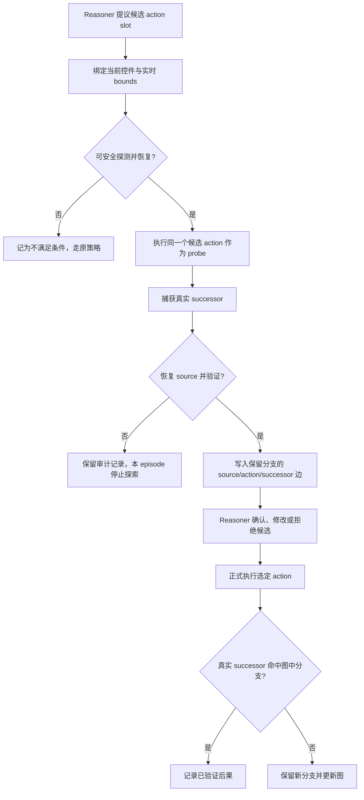

# MobileExplorer：从动机到 reasoning 的可验证闭环

## 动机与中间目标

截图/A11y agent 要把“控件在哪里”变成屏幕坐标，再把“点它会发生什么”交给模型猜。滚动、重排、弹窗、权限和动态数据会同时改变控件位置与 action 后态；因此静态页面节点、跨屏复用旧坐标或只存成功路径，都不足以支撑可靠 reasoning。

探索的中间目标应是**验证当前 reasoning 正在考虑的 action，在当前真实 UI 状态下会产生什么后果**，而不是把“多走页面”或泛化的信息增益当目标。Explorer 不读任务目标、不判断动作是否有助于完成任务；它只测量给定 `(runtime state, action slot)` 的真实转移。候选 action 可以来自 reasoner 的提议，因而“要测哪个 action”由当前决策提出；但记录的转移事实、恢复判据和图的边都不使用任务成功标签。这是 decision-conditioned、task-agnostic 的证据采集。任务完成与否仍由 AndroidWorld evaluator 单独判断。

## 动机到设计的闭环（给组会讲的论证）

| 观察到的问题 | 设计约束 | 可观测验证 |
|---|---|---|
| 坐标随滚动、重排、弹窗变化，历史位置不能代表当前控件 | 每次执行前用当前 observation 把语义 action slot 绑定到 live control 和 bounds；坐标只作本次执行参数 | 统计候选控件绑定正确率、可绑定/歧义比例，以及正式执行时重新定位后的命中率 |
| 同一控件动作的后果受权限、数据和系统状态影响，单张静态页面不能决定结果 | 在真实 source state 执行同一个候选 action，捕获 successor；以 source fingerprint + action slot 组织边，并保留多种 runtime-conditioned successor | source 恢复后复放，比较 successor；之后正式执行时分成已知分支命中、已知替代分支、新分支和不可匹配 |
| Reasoner 仅凭截图要同时猜“点哪里”和“会发生什么” | 把匹配且新鲜的 transition evidence 交给第二阶段 reasoning，让它确认、修改或拒绝候选；再实际提交所选 action | action grounding / slot 正确率、successor 命中率、错误导航和官方 evaluator success |
| 图的有用性不能从节点数或边数推出 | 配对比较 fresh matched edge、无 transition evidence、stale/wrong edge；固定模型、状态、历史和 token budget | fresh 优于 none 且 stale/wrong 不产生同等收益，才支持“这类图证据帮助 reasoning” |
| 探索可能改坏真实状态 | 只探测通过可逆/恢复门的候选；恢复失败保留审计并停止该 episode | 报告 eligible 分母、probe 数、恢复率、副作用和额外耗时；不靠放松门槛换覆盖率 |

**可直接对老师讲：**“我们不是想把 Android 页面尽量爬全，而是针对 agent 此刻犹豫的 action，在当前真实 UI 上验证它会到哪里。实时控件绑定解决‘点哪里’，真实 successor 加条件化多分支解决‘点了会怎样’。恢复后，reasoner 只能读取与当前 source 和候选 action 对齐的新鲜证据；执行后再由 verifier 检查是否命中已知分支或发现新分支。图是否有用不由大小判断，而由 fresh、none、stale/wrong 的配对决策结果判断；如果 fresh edge 没有提高 action 或 successor 正确性，我们就不能声称闭环成立。”

## 闭环设计

reasoner 提议候选 action → 绑定到当前 UI 控件 → 安全执行 probe → 捕获真实 successor → rollback/隔离验证 → 写入带分支的图 → reasoner 基于证据确认或修改 action → 正式执行 → 对比真实 successor → 更新图与 verifier 结论。

### 一句话研究主张

MobileExplorer 是一个 **action-outcome verifier**：对当前 reasoner 提出的候选 action，在真实 UI 上安全执行并观察后果，恢复后把“当前 runtime state 下该 action 可能到达哪些 successor”记为有来源、有置信度、保留多分支的图边；reasoner 执行前可读取它，action 执行后 verifier 再用真实后态核验。研究假设是：只有 source 与 action slot 对得上的新鲜 verified edge，才会改善 action 选择与 successor 预测；页面/边数量增加本身不构成有效性证据。

**“不 task-aware”需要精确定义**：Explorer 不读取任务答案/成功标签，也不以 evaluator reward 判断边是否有用；但要验证当前候选，probe 的 action slot 必然来自当前决策，因此“测哪个 action”是 decision-conditioned 的。若把“不 task-aware”解释成 action 选择也必须完全独立于当前任务，那就只能做通用 coverage；本轮随机 selector 的 0 次 probe→主动作匹配说明这类 coverage 不能自动闭合到当前 reasoning。

1. **观测与定位**：为本次 runtime state 保存 screenshot、A11y tree、activity、bounds 与结构指纹。模型/探索器使用当前 bounds 执行动作；跨状态绑定依靠 resource ID、稳定文本/description、控件角色等 anchor。若只有无标签几何节点，就标成 runtime-instance-only，禁止当作跨状态稳定控件。
2. **候选与探索**：reasoner 先给出一个可执行候选 `(control, action)`，必要时附上预期后态或不确定点。Explorer 不调用 VLM/LLM、不读取任务正确答案；它只判断该候选是否满足可逆/可恢复安全门，并在当前真实 UI 上执行同一个 action slot。若候选不可安全探测，就标记 ineligible，不能用放宽安全条件换覆盖率。纯随机地探测其他安全控件可用于建图 profiling，但不是这条闭环的主要 treatment。
3. **恢复与入图**：执行 recovery ladder 或使用隔离 snapshot，验证回到同一个 source runtime state。单次 probe 产生 `OBSERVED` edge；只有 source 恢复通过才可把它作为候选证据交给下一阶段。若在恢复后重放一致，升级为 `REPLAY_VERIFIED`；若随后正式执行命中该分支，升级为 `EXECUTION_CONFIRMED`。恢复失败留作安全审计并终止本 episode 探索。边记录 source family/runtime fingerprint + action/anchor + destination family/runtime fingerprint + 前置条件 + 探测/恢复/复验方式。同一 source/action 下的不同 destination 保留为并列分支，不能被“最后一次结果”覆盖。
4. **证据条件下的决策**：把 edge 的证据等级、真实 successor 和控件定位置信度交给 reasoner，让它确认原候选、选择另一候选或 abstain；是否修改 action 是单独记录的 outcome。之后正式执行选定 action，记录 live control、source 和真实 successor。只有 source/action 可匹配时，才可判为 KNOWN_OUTCOME、KNOWN_ALTERNATIVE 或 NEW_BRANCH；不匹配记 UNMATCHABLE。任务语义正确性继续由 evaluator 判断。
5. **图与 verifier 的闭环**：正式 action 到达后态后，verifier 对照图中该 source/action 的已知分支：命中已知后果、命中已知替代分支，或发现新分支。新分支被保留而不是当作模型错误；它也可触发动态状态刷新和后续复验。图因此同时支持“执行前给候选提供证据”和“执行后检查实际后果”，位置绑定与动态分支在同一条记录上对齐。

## 同一机制如何处理位置与动态性

- **位置 grounding**：候选 action slot 首先绑定到控件语义/角色，再把该 runtime instance 中实际 bounds 作为执行参数。正式执行时重新在当前 A11y/UI 里定位控件，再取新 bounds；绝不把历史 (x,y) 当作控件身份。没有可靠 anchor 的动作明确降级为实例内证据或不可匹配，不能跨实例复用。
- **UI 动态性**：屏幕 family 只用于归纳相似 layout；runtime fingerprint 表示具体数据、权限、滚动位置和系统状态。图记录一个 action 的多种真实 successor，新的后态可成为新分支，而不是覆盖旧边。exact runtime match 与 same-family/new-instance 需要分开报告，family 相同不自动等价。

这套机制是**显式表示并验证位置/后态的不确定性**，不是让 UI 变得静态：坐标仍可能因不可访问控件而无法跨实例定位，动态 successor 也可能随时间或服务端数据变化。没有稳定 anchor 的边只能作实例内证据；source fingerprint/条件不匹配的边不能标作 fresh；单次观测只证明该分支曾发生，不能声称已估计完整转移分布。只有在同一条件下重复采样，才可进一步估计分支概率。

这不是预先枚举整个 Android 世界的页面矩阵，而是针对 live UI 中尚未验证的转移逐步补边；探索频率、预算和候选数依真实耗时、恢复率与可匹配率调整。

## “图里什么信息有用”如何定义

图的核心信息不是“页面多”或“边多”，而是**当前可匹配的 source + action slot 对应的真实 successor 与变化分支**。对 reasoning 的 usefulness 不用图大小或启发式分数代替，直接在有匹配证据的 decision states 做配对干预：

- no-transition-context；
- fresh、同 source/action-slot 的已验证 transition；
- stale 或 source/action 不匹配的负对照，保持 token budget 相同。

测量正确 action/预期 successor 命中率、错误导航、官方 task success、额外 token/latency 和安全成本。只有 fresh edge 相对 no-context 改善、且 stale/wrong edge 不带来同等收益，才说明图中的关系信息确实帮助了 reasoning。若同源可用证据很少，这本身就是结果：当前 probe→reasoning 复用闭环不成立，需改为候选 action validation 或受控的两阶段推理，而不是继续调 selector 权重。

## 分阶段试验与因果边界

### Gate 0：运行和恢复

确认 AndroidWorld reset/evaluator、A11y capture、probe、rollback 与日志工作。任何恢复失败都不能进入可信图。当前实现是**同一 emulator 上 probe 后恢复**，不是双 emulator 隔离或零干扰系统。

### Gate 1：冻结的 40-task transition-validation pilot

使用既定 40-task cohort：20 个历史 baseline success、20 个 failure，18 个 app，包含低/中/高复杂度；seed 34 与 task 参数固定，历史成败只作分层。每个 eligible inference window 最多一个安全 probe，max depth 1；关闭 graph prompt、replay、skip 和 action substitution。8095/8096 当前都返回 GELAB-ZERO-4B，所有结果标成 pilot / GELAB-ZERO-4B，不能并入 MAI-UI 2B 主结论。

Gate 1 首先回答：有多少屏幕可安全探测、probe/recovery 是否可靠、控件/action 能否稳定绑定、主动作有多少可与 probe 边匹配、动态 successor 是否被正确保留、成本是多少。它不是 reasoning 提升试验，也不应期待关闭 prompt/action 修改后任务成功率上升。先用修过的 action binding 做同 task 冒烟，确认匹配日志有效，再用两个 LabServer worker 按实际 task/hour 动态跑满冻结的 40 个 task，不根据成败替换任务。

### Gate 2：transition evidence 是否增强 reasoning

用两阶段闭环形成配对 decision states：第一阶段 reasoner 输出候选 action slot；仅对满足严格可逆/可恢复门的候选执行真实 probe 并恢复；第二阶段 reasoner 看对应 treatment 后确认、修改或拒绝候选。Explorer 不看任务目标或答案，证据只是这个 source/action 在真实 UI 上的后果。

在相同 task/seed/决策状态上配对比较三种第二阶段输入：**fresh**（source 恢复通过、与当前 source/action 精确匹配的新鲜 edge，并显式提供它是单次 observed 还是 replay-verified）、**none**（没有转移证据）、**stale/wrong**（source、action 或 runtime 条件不匹配的边）。三组都运行相同两阶段流程并对齐调用次数、prompt token budget、模型、截图/历史、decoding 和决策状态；只改变 transition evidence。单独报告满足 probe 安全条件的 eligible 分母、实际执行 probe 数和 evidence match 数，避免只报易匹配案例。

**Gate 2 的入场 smoke 与配对单位：**先用人工指定的只读、可逆控件（例如 Settings 内部导航）和 0 次模型调用验证 probe→恢复→同动作 replay 的状态/分支日志；这只验收机制，不是 gold task trace。再让 GELAB-ZERO-4B 在同一个 live source 提出候选，只有候选绑定到明确 control/action slot 且通过既有安全门时才探测，逐项确认日志链为 `proposed slot → exact-slot probe → captured successor → verified source recovery → second-pass evidence → committed action → successor verdict`。第一阶段候选在三种 arm 间冻结；每个 arm 从等价 reset/checkpoint 重放到同一 source，并执行相同的 probe/recovery 和两次模型调用，只对第二阶段隐藏、显示 fresh edge 或替换成等 token 预算的 stale/wrong edge。候选不可探测或无法重建同一 source 时记为 ineligible/unmatched，不偷偷替换候选，也不放宽 safety gate。action-slot 正确率只在有人工标注的 reference decision states 上报告；VLM 轨迹不能作 gold，task evaluator 是全 task 的独立终点。

主要终点是第二阶段所选 action 的 grounding/slot 正确性、正式执行后的 successor 命中率、错误导航/无效动作与官方 evaluator task success；同时报告额外模型调用、token、latency、恢复失败和 UI 副作用。只有 fresh 相对 none 有收益，且 stale/wrong 不产生同等收益，才支持“图中的转移关系帮助了 reasoning”。验证阶段不把 action 自动修改、重试、跳步或宏执行合并进主要处理；若要启用，另做独立因子/消融。

### Gate 3：完整覆盖与模型复验

全 registry 的 116 个 task 已在同版 GELAB-ZERO-4B 随机-selector 配置下完成 coverage/runtime profiling，覆盖 20 个 app；40-task 分层 pilot 与剩余 76-task extension 合计，不能解释为 reasoning intervention。新 treatment（候选 action-conditioned 两阶段闭环）仍需单独做安全 smoke 与配对 evidence 对照；若论文对该新 treatment 声称全 116 覆盖，必须将该版本另跑完整 116，不能与随机-selector 版本混合。GELAB-ZERO-4B 只用于工程筛选；最终论文主结论仍需 MAI-UI 2B 单独复验。

## 当前实测与下一步

- 40-task cohort 已冻结，历史 baseline 成败各 20、覆盖 18 apps；仅用于分层，不等于本 pilot 结果。全 registry 逐 task seed-34 记录可核实 115 行（53 success、62 failure），`SimpleSmsReplyMostRecent` 的逐 task 标签缺失；旧 aggregate 的 54/62 总表与逐 task 记录尚未对上。
- `SimpleSmsReplyMostRecent` 仍以 `historical_outcome=unknown` 保留在 116-task roster；不从总数反推标签、不替换任务。
- **40-task GELAB-ZERO-4B pilot 已完成**：40/40 task、18 apps、低/中/高复杂度 17/17/6，历史 baseline 成败各 20；当前模型 evaluator 18/40 成功（baseline-success strata 为 13/20、baseline-failure strata 为 5/20），仅报告为 pilot outcome，不代表探索带来提升。
- 两台 worker 的主队列 38 task 用时 33 分 38 秒，吞吐 67.8 task/hour；连同先行 throughput check 的 2 task，40 task 端到端约 38 分 33 秒，约 62.2 task/hour。每 task 执行墙钟均值约 103 秒，中位数 98 秒；该实测吞吐用于设置剩余 76-task extension 的双 worker 动态队列；长尾明显。
- **转移与安全结果**：44 probe attempts，41 次恢复成功、3 次恢复失败（NotesIsTodo、NotesRecipeIngredientCount、RetroCreatePlaylist，全部为 SCROLL）；23/44 改变 layout，21/44 为 no-op。3 次失败都停止当前 episode 的后续探索，没有被丢弃或计作 verified edge。
- 410 个 authoritative actions 中 368 个可绑定到 action slot（89.8%）；但此前 source 恢复通过的 probe observation 与后续 authoritative action 的 source/action 精确对齐为 **0/368**。这里“恢复通过”只说明回到了 source，不代表 probe 后态已被独立重放确认。44 个 KNOWN_OUTCOME 与 11 个 NEW_BRANCH 都来自 authoritative path 自己的历史记录；不能算 exploration 验证了主动作。probe stop reasons：no_safe_candidate 128、candidate_rejected_or_no_progress 43、budget_exhausted 41、reasoning_finished 53、recovery_failed 3（共 268 inference windows）。
- **全 116 coverage/runtime profile 已完成（GELAB-ZERO-4B pilot）**：116/116 task 产物及 evaluator checkpoint 齐全；模型 evaluator 50/116 成功、66/116 失败，仅描述 pilot outcome，不是 exploration 的因果效果。全程 20 apps、838 inference windows、1206 agent steps；139 次 probe 中 131 次 source recovery 通过（94.2%），8 次失败；79 次 layout-changing、60 次 no-op。1108 个 authoritative actions 中 945 个可绑定 action slot（85.3%），但与先前恢复通过 probe 在相同 source/action 上匹配为 **0/945**。控制器剩余 76-task extension 用时 61m39s（73.9 task/hour；均值 97s、中位数 86s、最大 259s），队列没有 process error 或 timeout。全量 stop reasons 为 no_safe_candidate 472、candidate_rejected_or_no_progress 99、budget_exhausted 131、reasoning_finished 128、recovery_failed 8。authority verdicts 为 UNMATCHABLE 997、KNOWN_OUTCOME 85、NEW_BRANCH 26；由于 probe 对齐数为 0，后两类只来自正式执行路径自身历史，不能算 exploratory evidence 命中。
- 结论：当前随机安全 probe 可覆盖一些真实 UI 转移且多数能恢复，但**没有形成探索证据→候选推理/验证的连接**。不能靠继续加随机 probe 预算解决。全量 116 仅回答 coverage/runtime/matchability，不回答 reasoning 增益。下一步是候选 action-slot 对齐的两阶段方法：先做安全 smoke，再配对比较 fresh/none/stale-or-wrong；新 treatment 的任务成功和推理结论单独报告。
- **安全 probe 冒烟**：MarkorDeleteNote 有 7 个 inference windows、0 probe；SimpleCalendarAddOneEvent 有 19 个窗口、0 probe（主要停止原因为 no_safe_candidate）。保留为可探测机会率的负例，不能通过放宽 safety filter 把它们伪装成成功覆盖。
- **FilesMoveFile / GELAB-ZERO-4B pilot**：retry4 做出 2 个 SCROLL probe，2/2 recovery verified；一个产生新 layout successor，一个为 no-op。原实现的 10 个主动作全不可匹配。定位到 action hit-test 取 UI tree 中第一个包住坐标的节点，常落到整屏 FrameLayout。
- 修复后 retry5 重新跑同 task、seed 34：2/2 probe recovery 成功；7 个真实主动作中 6 个绑定到可访问性控件或语义 app target（6/7 可匹配），但 0 个能与这两条随机 SCROLL probe 做 source/action 匹配，因此仍没有 transition verifier 的正匹配。GELAB-ZERO-4B 本身这次 task evaluator 失败；该 arm 不改变 action/prompt，不把失败归因于 exploration。
- 修复内容是按坐标选最小兼容 clickable/editable 控件、对唯一 scroll container 做实例内绑定，并给 probe swipe 显式记录方向；歧义目标宁可记为 unmatched。新 action-binding 与在线 evidence/runtime 测试共 15 项通过。
- `FilesMoveFile_alignment_diagnostic_max2` 把每窗口预算上调到 2（其余仍是同 task/seed/4B、depth 1），实际仍只做出 2 个安全 SCROLL probe，2/2 恢复；7 个主动作中 6 个可绑定，0 个和 probe transition 对齐，且 swipe action 本身有一屏因无唯一 scroll-container 绑定而 unmatched。提高 probe 数没有打开 TAP_NAV，因为当前策略要求当前 screen 先有 exact-recovery probe 才允许进一步 navigation probe；因此这是 selector/eligibility deadlock 的诊断证据，不是“预算不够”的证据。`FilesMoveFile` evaluator 失败。
- 独立 expert-trace harness 可由人工直接输入 action，当前 model_calls=0。FilesMoveFile 手动探索仍是未完成 trace，target 文件在已打开的 Movies UI 中未出现，validated_reference=false；不计入 gold reference。
- 另有一条有效人工参考：`TurnOffWifiAndTurnOnBluetooth`，seed 34，10 个由人工依据真实设置页选择的 action，0 次模型调用，官方 evaluator score=1.0，`validated_reference=true`。之前的 `SystemBrightnessMinVerify` 也是 evaluator 验证的人工参考，但初始状态已满足目标，单独标记为 pre-satisfied，不作为需要状态变更的路径证据。
- **同源 action replay smoke（人工机制诊断，不是 4B run）**：在同一个 seed-34 Settings 页面手动点击 `Network & internet`（坐标 380,860），点击 Navigate up 恢复，然后在恢复后的同源屏幕再次执行同一点击。用可交互布局签名验证，原 source 与恢复后的 source 都为 `43acda25ee7a8c52f97`；第一次 probe successor 与 replay successor 都为 `319d5259ca0cb97a9ac0`，即一次家族/slot 级 KNOWN_OUTCOME。source 的全结构签名因 Storage 百分比从 47% 变成 48% 而不同；该 home row 在 A11y 中也没有暴露 clickable 父节点，所以这个 smoke 只验证“同 runtime 实例下坐标 action 可重复产生同 family successor”，没有证明跨实例稳定控件定位，也没有证明当前 MobileExplorer verifier 已集成这条 exact comparison。立即截图/A11y 快照会在转场中短暂不一致，恢复判断应等稳定 capture。

因此当前实现的核心阻塞点是**在线 probe 与主决策的 action-slot 对齐**。手工 replay smoke 已验证转移可以在恢复后复验；随机 selector 的 max2 诊断及全 116-task profile 中，probe→authoritative source/action 匹配均为 0，单纯加预算不能解除安全门控。40-task pilot 与剩余 76-task extension 已合计完成 116-task 随机 4B coverage；不能把随机 SCROLL 说成 candidate validation。下一步是候选 action-conditioned 两阶段闭环和小型安全 smoke；候选只在可恢复/可逆或有隔离 snapshot 时执行，失败保留审计并停止。正确 expert traces 单独由人工 action harness 收集，不能拿 VLM 轨迹充当 gold；reasoning 增益要等 Gate 2 的 matched pairs 才能回答。

## 模型与轨迹边界

- 人工 expert profiling：不调用 VLM，由我根据当下真实 UI 直接输出 action；只有 official evaluator 验证通过的 trace 才能标 gold。
- GELAB-ZERO-4B live runs：用于 40-task transition-validation pilot 与独立的 76-task 全 registry coverage extension，必须标 pilot，不能叫正确轨迹或 reasoning 提升证据。
- MAI-UI 2B：最终论文主模型复验。
- 图只保存观测转移，不把“回滚成功”“模型到了这个页面”误当任务语义正确。
