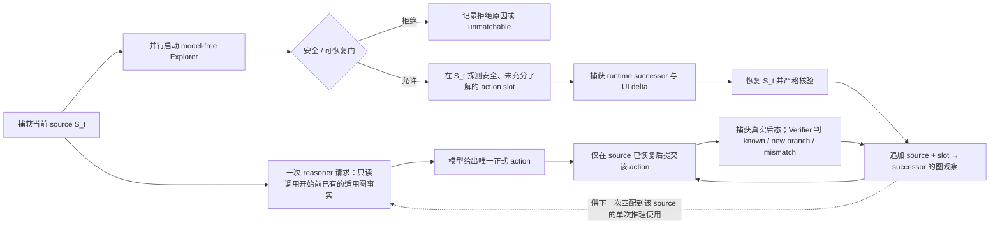
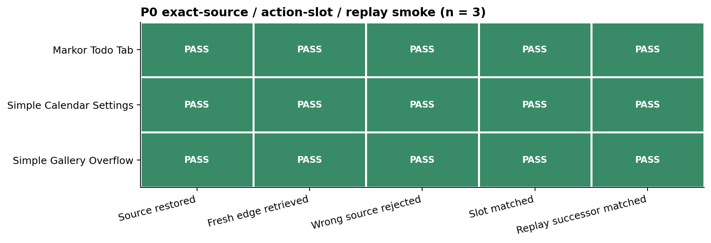
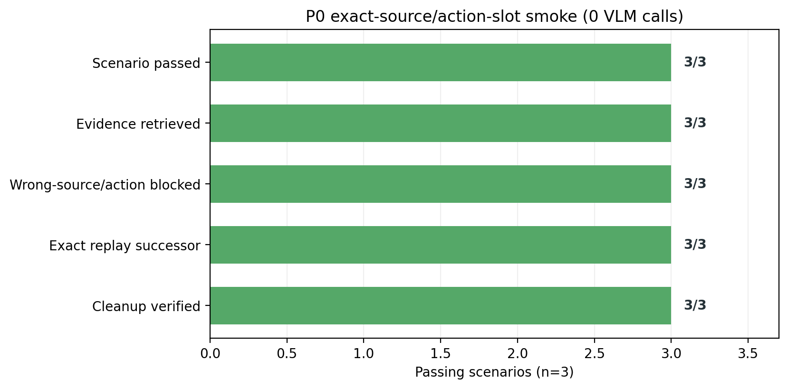
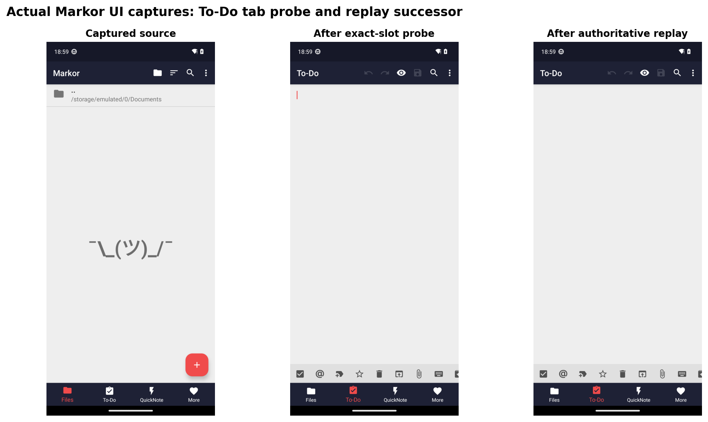
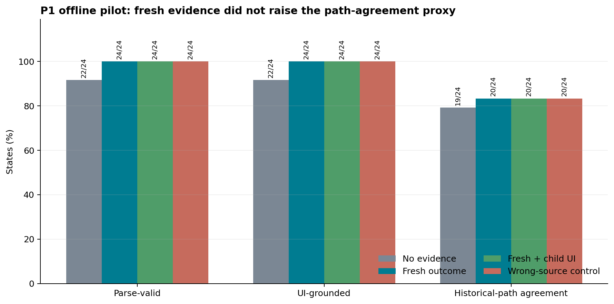
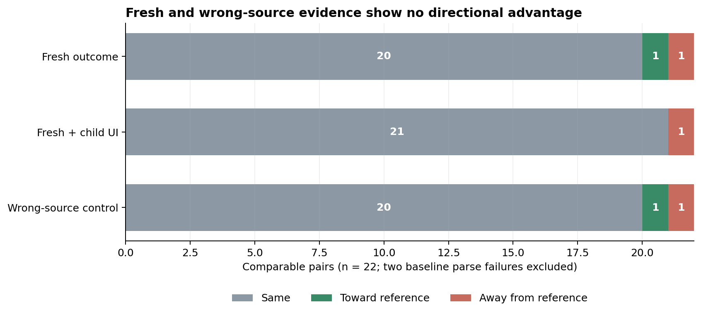
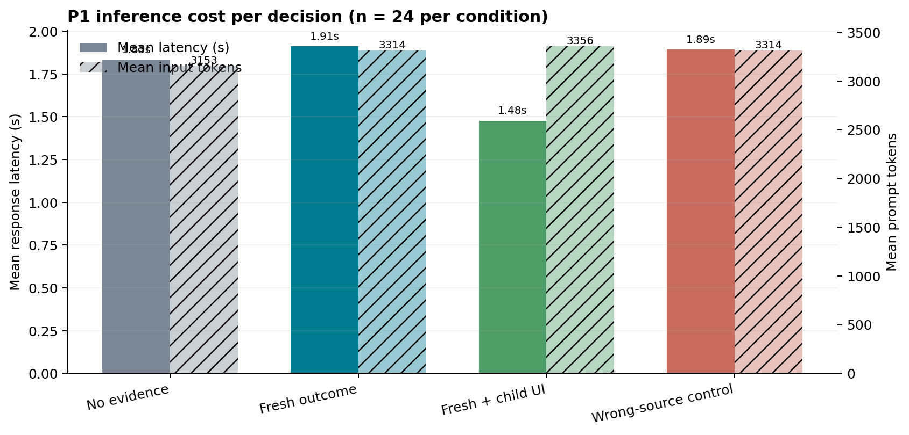
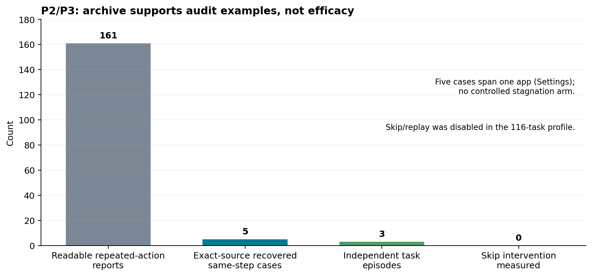
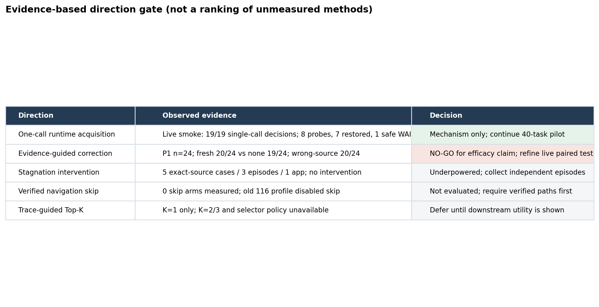

# MobileExplorer 设计验证：从动机到闭环

**状态：** safety-v1 one-call acquisition primary cohort 已完成 116/116 个 task：1,029/1,029 个实际决策请求各一次 GELAB-ZERO-4B 推理；245 次 probe 中 224 次严格恢复、21 次失败。校正协议错误后是 51 pass、54 fail、11 unknown。730 次 evidence retrieval 中只有 24 条记录真正进入 prompt；5 个决策精确对齐 source/action/successor。全量统计见[116-task summary](../../info_value_profile_20261012/private_voi8-live-20261012-fd89ba/summary_onecall_formal_116_safety_v1_20261013.md)。结果是 GELAB-ZERO-4B pilot，不是 MAI-UI 2B 主结果；没有 no-exploration 对照，因此不声称 reasoning/task-success 增益。另对 5 个 unknown 做了隔离重试，未覆盖 primary 结果。

当前阶段每项实验的图表与一句话结论见[结果图表索引](experiment_results_figures_and_conclusions_20261013_zh.md)。

## 先说结论

MobileExplorer 的合理设计单位不是“探索一张页面”或“向图里加一条泛化知识”，而是：**在当前真实 UI 上验证安全候选 action slot 会产生什么后果，再把这个 source/action-slot/successor 关系作为后续单次推理的可用证据和正式执行后的 verifier 依据。** 每个决策点仍只有一次 vLLM 推理；Explorer 与这次推理并行工作。并行 probe 刚得到的结果不能倒灌到已经发出的 prompt，只能在恢复后写入图，供之后匹配到该 source 的一次推理使用。

本轮有四条确定结果：

1. P0 精确对齐机制已在 3 个只读、可逆导航例子中通过：source 恢复、exact-source 检索、错误 source/action 拒绝、action-slot 匹配和同动作 replay successor 匹配均为 3/3；后续安全门与 one-call 回归测试共 171 passed。
2. P1 的配对离线 pilot 没有显示 fresh transition evidence 的独有收益。历史路径一致率是 no-evidence 19/24、fresh outcome 20/24、fresh outcome + 子页面 affordance 20/24、错误 source 对照 20/24。action 没有实际执行，这个指标只是历史轨迹一致性代理，不表示动作正确或任务成功。
3. safety-v1 live runner 已覆盖 116 个 task 的 1,029 个决策请求，全部为 `inference_calls=1`；reasoner 与 Explorer 并行。恢复失败时丢弃旧 source 上的 action、返回安全 WAIT，下一步 fresh capture 后仍只作一次正常推理。
4. 全量实测 245 次 probe 中，160 次改变 strict `structural_signature`、138 次改变 `layout_signature`（interaction skeleton），但 245 次都没有离开当前 Activity；40-task 子集分别为 58/101 和 51/101。本文将“UI structure change”统一定义为同 Activity 下 `layout_signature(source) != layout_signature(probe successor)`；`structural_signature` 包含文本、selected state 与 16px 量化 bounds，会把内容变化和滚动也计入，因此只作为敏感度更高的补充指标。菜单、搜索、列表和滚动等同 Activity 变化说明状态图需要 runtime fingerprint 与结构差分，activity/page label 单独不足以建图。21 次恢复失败的分类见全量结果；失败探测事实没有进入 prompt。

因此目前可以说“source/action/successor 的记录与验证链能工作”，还不能说“图中转移信息增强 reasoning”。错误 source 对照与 fresh evidence 的表现相同，说明这版 prompt/evidence 没证明模型在利用证据的 source 条件；也可能是这项小样本、离线代理指标不够敏感。不要把结论外推为 transition graph 没有价值。

## 动机到设计的闭环

静态 UI 描述能给出可见控件与当前位置，却不能总是判断一个候选 action 的后续结果。相同的坐标可能在滚动、权限、数据刷新或系统状态变化后落到不同控件；同一页面 family 也可能有多个真实 successor。单靠页面矩阵或模型记忆无法验证当前 action 在当前 runtime 下是否仍成立。

把“runtime dynamic”落实到设计时，需要分别回答三件事：Explorer 该观察什么、图如何表示观察到的变化、什么证据才算对 reasoning 有帮助。

| 要解决的问题 | 设计 | 本地技术与可观测量 |
|---|---|---|
| 静态截图看不出候选操作的真实后果 | Explorer 在真实 UI 上执行通过安全门的 action slot，保存操作前后状态及 UI delta；它测量的是 `source + action → successor`，不是再描述一遍 source 页面 | 双进程并行：reasoner 对探测前截图发出唯一一次请求，model-free Explorer 同时做有界 probe；截图/无障碍树、activity、结构/布局/视觉指纹和控件 selected state 形成状态签名。严格恢复 source 后才继续执行模型 action |
| 坐标随滚动、布局及数据变化而漂移 | 用语义 ActionSlot 对齐“哪个控件/哪种动作”，不把历史坐标当作跨截图身份；若以后要重放图中动作，必须先在 fresh hierarchy 唯一定位，再用当前 bounds 执行 | 唯一 resource-id 优先，其次唯一 description/text + class；保留动作类型、scroll direction、当前 bounds。**当前 pilot 已实现坐标命中控件并生成 slot，用于 source/action 匹配与验证；尚未实现把历史 slot 自动重定位后改写执行坐标，因此不宣称验证了跨截图动作重放。** |
| 相同 Activity 内有菜单、tab、列表等不同 runtime state | 分开建状态 family 与严格 runtime observation；同一 source/action 允许有多个 successor branch，而不是以最后一条结果覆盖旧结果 | family 用 activity + interaction-layout signature 聚合；runtime 用结构/视觉/selected-state 等严格签名校验。边保存观察到的 successor 集合、delta、探测来源和恢复结果；按 `layout_signature`，51/101 次 pilot probe 在 Activity 不变时改变了交互骨架 |
| 怎样找到值得记录的信息，避免手工“看起来有用”的规则 | acquisition 按转移模型不确定性排序，安全与恢复是硬门槛；探索器不读 task goal。先采集可能改变 action 后果的事实，之后再由任务相关 reasoning 判断它是否适用 | 可检验的目标是 `EIG(source, slot → successor) / (probe + recovery cost)`：对 successor 分支维护 Dirichlet posterior 与显式 unknown 分支，选择期望降低预测熵最多的安全动作。当前 pilot 使用 CoverageRanker 作为未知控件覆盖基线，尚未声称已实现或验证这套 posterior selector |
| 新观察能否帮助推理、以及图能否做 verification | 把探索边作为“预期后果”证据；正式 action 执行后再比较真实 successor，标记命中已知分支、出现新分支或不匹配。转移正确性与 action 对任务是否正确是两个判断 | evidence 只能来自恢复成功且早于当前请求提交的记录；在线 verifier 比较 source/ActionSlot/successor。记录 prompt 是否选入证据、模型是否选择同一 slot、后态 verdict 与 evaluator。task uplift 必须用同 checkpoint 的 evidence / no-evidence / wrong-source 配对测试，而不能从 probe 数量推断 |

这张表刻意把“采集信息的价值”和“信息对某个任务的效用”分开：前者可以 task-independent 地学习 UI 的动态转移；后者要看具体请求是否能精确命中证据、模型是否据此作出更好的 action，以及执行后是否到达合适 successor。**只观察到 runtime 变化证明 exploration 获取到了动态；只有后续配对执行改善，才能证明它有助于 reasoning。**

在“一次推理 + 并行探索”的约束下，Explorer **不能先等本轮 reasoner 选出 action 再验证它**：那会变成先后两次模型决策，退出并行关键路径。因此本设计把探索候选定义为当前 hierarchy 中经过安全/可恢复门筛选的 action slot，由 model-free Explorer 根据已有图的未知度/分支不确定性选择；它不读取 task goal，也不依赖本轮尚未返回的模型输出。Explorer 在同一 runtime 上真实执行可逆 probe，捕获 successor 和 UI delta，严格恢复后把 observation 追加到图。当前这次模型请求仍只读 prompt 发出前已提交的图；新 observation 可供后续匹配到该 source 的一次推理检索。若本轮正式 action 恰好命中本轮 probe slot，则正式后态可立刻核验该 probe；否则本轮只得到 acquisition，不应声称已经帮助了当前推理。图保留多种 successor，不以新观察覆盖旧结果。

**时序边界：** 同一决策点的 VLM prompt 在并行探索结果返回之前就已发出。因此，刚完成的 probe 不能指导这一条 response；它只能在后续同源决策里被检索，或在当前模型 action 恰好与 probe slot 一致时，用正式执行后态完成验证。若探索改变 UI 却没能恢复，不能执行基于旧 screenshot 的坐标 action；本实现现在以 WAIT 丢弃旧 action，避免加发第二次推理。这里的并行指一个 Explorer 与一个 reasoner 在同一 emulator 上重叠运行，agent 的正式 action 必须等 Explorer 完成恢复检查之后才能执行，不允许两个控制器同时发 UI action。

### Action slot 如何容纳位置和动态性

- 对稳定可访问控件，action slot 以当前 source 中唯一的 resource ID、文本/描述和控件类型作身份；hit-test 从当前 hierarchy 找出模型/探测坐标对应的控件，并把此刻 bounds 放进 slot。历史坐标不充当跨实例身份。**当前 pilot 用 slot 做精确匹配和 post-action verification；模型生成的正式坐标仍按其本轮截图执行。若将来要重放旧 edge，需另加 fresh-hierarchy resolver 并要求唯一匹配；这项跨观察重定位还没有在本轮实测。**
- 对匿名/重复控件使用 source/runtime 限定的实例身份与 bounds；无法唯一命中的动作保留为 ambiguous/unmatchable，不升级成可跨实例复用的证据。
- source family 与 runtime observation 分开。family 表示相似布局；runtime 指纹表示当前实际状态。完整 transition 以 source runtime + action slot 为键，successor 是观测记录；strict runtime 相同、same-family 新 runtime 和 new family 分开报告。
- 当前 UiElement 没有可用的 hierarchy ancestry，P0 slot 中该字段为空。依赖 ancestry 的跨实例泛化尚未验证。

### 如何找到“更有帮助”的信息，而不让 Explorer 读 task goal

“有帮助”分 acquisition 和 downstream utility 两个概念，不能用同一套手工权重混在一起：

1. **采集目标保持 task-independent。** 对当前可见的 UI controls 构造 ActionSlot 候选；先按不可逆/不可恢复安全门过滤，再在可行动作中估计“再观察一次能减少多少转移不确定性”。目标可写成 `a*=argmax_{a∈C_safe(s)} I(Θ_{s,a};S'|D)/(probe+restore cost)`，并将预测恢复概率作为安全准入/成本项，而非混成任意收益权重。候选 successor 用 runtime fingerprint 聚类；对分支计数可用 Dirichlet-categorical posterior，并保留 `novel successor` 类别：无历史的 slot 由先验 novel-outcome mass 表达未知，有重复观测后按后验预测熵/信息增益安排复探。相同且成熟的边降低重探优先级；重观察机会受 runtime 是否发生可检测变化约束。goal/task text 不进入排序输入。起步实现可把 `CoverageRanker` 作为简单、可复现的 unknown-frontier baseline；它只奖励未见过、可命名控件及部分 role，目前不是 EIG，也不是最终算法。后续是否值得实现 posterior ranker，由 downstream utility 和成本数据决定，不用手工 heuristic 权重包装结论。
2. **信息内容围绕 action consequence，而非页数。** 一次 observation 至少保存 successor runtime/family、activity、结构/layout 变化、子页面可见 affordance、capture 时间、action slot、恢复结果和来源；把屏幕/控件 delta 附着到 source/action，而不是把变化压成“这个页面是什么”的全局摘要。
3. **有帮助与否由后续 reasoning 和执行来裁决。** 记录图事实何时已提交、是否在当前 prompt 之前、是否匹配当前 runtime、agent 是否选择了同一 slot、正式执行后的 successor verdict 和 evaluator 结果。比较 fresh / none / wrong-source 时，每个条件每个决策点都只有一次正常推理；不在一次调用里追加复问，也不把“模型改了 action”自动计为有帮助。新 evidence 的适用机会率（source 命中率）与命中后的 action/task 效果必须分开报。严格单次调用下，在线 probe 当前轮不能直接造成当前轮 reasoning uplift；因果效用要在 evidence 已于调用前存在、并从同一 checkpoint 开始的后续决策/配对 episode 测。

这样，探索器只负责模型无关的 runtime 信息获取；task-aware reasoner 在唯一一次正常请求中解释调用前已有的事实。当前 P1 发现 fresh 与错误 source 对照没有差别，说明还未证明 acquisition 的 transition 信息能提高下游决策；下一步要测适用率与真实执行效果，而不是先优化启发式 selector。

这不是一次观察就估计转移概率。未经重复采样的图边只表示“曾在这些条件下发生”。

## P0：source/action-slot/replay 对齐

修复后的 hit-test 选择坐标命中的最小兼容 clickable/scrollable 控件，不再取第一个包住坐标的整屏容器；scroll action 记录方向；歧义动作不匹配。图/evidence key 优先使用 ActionSlot。正式 action 的比较限定在同一 source runtime 与同一 action slot；successor 只在动作实际执行、后态捕获后比较。移除了仅因 successor 相似就补齐 source/action 对齐的路径。首次安全导航 tap 可以在严格 preflight 和 recovery gate 下被探测，不再要求先有熟悉记录。

3 个实际设备 smoke 均为 `model_calls=0`：

| 场景 | 探测 / 恢复 | Source 5 项检查 | Slot 与 replay successor |
|---|---|---:|---:|
| Markor To-Do tab | 点 To-Do / 反向点 Files | 5/5 | exact slot、runtime、family 均匹配 |
| Simple Calendar Settings | 打开 Settings / Back | 5/5 | exact slot、runtime、family 均匹配 |
| Simple Gallery More options | 打开菜单 / Back | 5/5 | exact slot、runtime、family 均匹配 |

每例还满足 fresh edge 可检索、错误 source/version 检索为 0、错误 action 被拒绝、最终 cleanup verified。样本是三个特定 app/runtime 的导航机制 smoke，不代表更广的控件类型覆盖，也不证明 task success。

代码与审计：[`ActionSlot`](../../../android_world/parallel_exploration/action_slot.py)、[`live_probe.py`](../../../android_world/parallel_exploration/live_probe.py)、[smoke audit](../p0_exact_match_smoke_20261013/me-p0-smoke/audit.json)。在已有 AndroidWorld 容器依赖环境中，把本次编辑后的源码复制到隔离目录后运行 action-slot、live-probe、one-call fallback、serial-generation、online-evidence-index 和 belief-graph 测试，**171 passed**；相关模块和 runner 的 `py_compile` 也通过。宿主 Python 环境单独跑 pytest 缺少 `absl`，所以测试计数来自 AndroidWorld 容器环境，而不是宿主环境。

**0/945 的根因要分两类，不能都归为 binding bug。** 实现层面，旧 hit-test 会把坐标绑定到第一个包住坐标的大容器，swipe direction 也可能没有进入 slot；这会让语义相同的真实动作无法匹配。策略层面，旧 selector 随机探索，其 action 与随后正式 action 本来就经常不重叠；再加上 navigation 探索要求先有熟悉的 recovery probe，形成只能继续试 scroll 的 eligibility deadlock。当前修正分别改了最小控件绑定、方向归一化和首次安全可逆 navigation 的恢复 preflight；没有放宽 source/action identity。**三例证明受控正反例的机制有效，未证明在线 candidate selector 已消除任务中的 policy non-overlap。**

## One-call live smoke：单次推理与并行 acquisition

用更新后的 source 在两个 LabServer emulator 上并行跑了 `ContactsAddContact`（旧 baseline pass）和 `BrowserMaze`（旧 baseline fail），两者均使用 GELAB-ZERO-4B、`CoverageRanker`、每轮最多一个 probe、depth=1、`fast_provider`。这只是在线时序/安全 smoke，不是 reasoning utility 对照。

| task | 决策数 / 单次请求检查 | probe / 恢复 | 任务结果与旧 baseline |
|---|---:|---:|---|
| ContactsAddContact | 9；9/9 行 `inference_calls=1` | 1 / 1 恢复 | pass / baseline pass |
| BrowserMaze | 10；10/10 行 `inference_calls=1` | 7 / 6 恢复、1 失败 | fail / baseline fail |
| 合计 | 19；19/19 行 `inference_calls=1` | 8 / 7 恢复、1 失败 | 不能据此判断效果 |

BrowserMaze 的失败 probe 点了 DocumentsUI 的 “List view”，真实观察到了同 Activity 内从列表到网格的 UI 变化；旧恢复链把 Android 系统文件管理器误作 app alias，严格 source 校验失败。one-call fallback 丢弃了旧 screenshot 对应的 action、执行 WAIT，记录 `additional_inference_calls=0`，下一 step 重新观察后继续。同一 episode 将该 activity 下触发失败的 TAP_NAV recovery context 加入 blocklist，随后仍可安全地尝试 SCROLL probe。这个样本直接说明 runtime delta 有信息，但“观测到变化”仍不等于安全/有用的证据。

ContactsAddContact 的平均 step latency 为 5.04s，BrowserMaze 为 6.37s；BrowserMaze 的单次恢复失败使 critical-path extension 达 12.88s，其余大多数轮次为 0–2.5s。样本只有两个 task，不能据此估计总体吞吐或 task-success 差异。run data 与配置：[one-call smoke manifest](../../info_value_profile_20261012/private_voi8-live-20261012-fd89ba/onecall_runtime_smoke_fastprovider_20261013/manifest.json)、[Contacts request log](../../info_value_profile_20261012/private_voi8-live-20261012-fd89ba/onecall_runtime_smoke_fastprovider_20261013/ContactsAddContact/request_latency.jsonl)、[Browser probe trace](../../info_value_profile_20261012/private_voi8-live-20261012-fd89ba/onecall_runtime_smoke_fastprovider_20261013/BrowserMaze/probe_trace.jsonl)、[safe WAIT audit](../../info_value_profile_20261012/private_voi8-live-20261012-fd89ba/onecall_runtime_smoke_fastprovider_20261013/BrowserMaze/dirty_events.jsonl)。首轮 `grpc` setup 因 APK 签名不一致在推理前失败，未执行 task action；有效 smoke 改用 emulator 已安装的 `fast_provider`。

### 安全门校准与 40-task v1 结果

先前宽松候选门的校准数据不并入正式 pilot：Browser 的 DocumentsUI “List view”、Calendar 的小时值控件和系统 chooser 中的滚动均出现过恢复失败。正式 v1 的 101 次 probe 有 95 次严格恢复、6 次失败（94.1%）；失败集中于 DocumentsUI 两次、Clock Alarm tab 两次、Retro Music tab/scroll 两次，根因是 app alias 无法重进或 selected-state 逆动作没有绑定到正确的同组控件。每次失败都丢弃旧 action 并 safe WAIT，没有第二次推理。`OnlineEvidenceIndex` 的 retrieval 只返回 recovered observation；本轮 5 条未恢复记录均未被选入 prompt。后续应把 inverse plan 绑定到具体 action slot、把未知 app alias 解析到实际 package，并单独验证 scroll offset 恢复。

修改后的回归集 **171 passed**。v1b BrowserMaze smoke 为 12/12 单次推理，5 条 probe 全部恢复；两个 framework chooser 上下文都按门控被跳过。冻结的 40-task cohort 全部结束：18 个 app、baseline pass/fail 各 20 个、复杂度 low/middle/high 为 17/17/6；406/406 个决策各一次推理，平均 task wall time 108.8s（双 worker 总墙钟 48.8 分钟）。原始 evaluator 为 20 pass/20 fail；FilesDeleteFile 在首次 task action 前报 `No app name provided`，按 unknown 修正，因此可评估结果是 20 pass/19 fail/1 unknown。该结果验证 acquisition 的运行机制与覆盖，不是 no-exploration 对照，不支持 task-success uplift。

在 40-task v1 的 266 次 evidence retrieval 中，9 条 transition records 真正被选入 prompt；5 条未恢复 observation 没有一条被注入。406 个决策里有 2 个 source/action-slot/successor 三者都精确匹配的在线对齐案例。按统一 `layout_signature` 定义，51/101 probe 改变交互骨架；若看更敏感、会响应文本/位置/滚动的 `structural_signature`，则为 58/101。两项都没有 Activity 变化；这支持“runtime state 不能只按 activity/page 切分”，却尚未证明新 observation 提升后续 reasoning。可复核的完整统计见 [v1 summary](../../info_value_profile_20261012/private_voi8-live-20261012-fd89ba/onecall_formal_cohort40_safety_v1_20261013/summary_formal_v1.md)。

计数口径需要留意：当前 retrieval event 的 `eligible` 字段统计的是 source/posting 命中数，发生在 recovery gate 过滤之前；它不能当作真正可注入的证据数。因此这里用 `selected` 记录来统计实际进入 prompt 的 9 条 evidence，而不报告那个偏大的 pre-filter 计数。

### 完整 116-task safety-v1 acquisition 结果

disjoint 的 40-task cohort 与 76-task extension 合起来覆盖 20 个 app，baseline 分层为 53 success、62 failure、1 unknown；复杂度 low/middle/high 为 62/31/23。1,029 条 request log 全部是 `inference_calls=1`，探索进程与唯一一次推理并行运行。校正 11 个 protocol unknown 后，primary evaluator outcome 为 **51 success / 54 failure / 11 unknown**；这只是描述性 task 结果，没有 matched no-exploration 对照。

全量有 245 条 probe observation，224 条严格恢复（91.4%）。raw `graph.src` 与 `graph.dst` 显示这 245 次都留在同一个 Activity 名称下；`structural_signature` 有 160 次变化（65.3%），`layout_signature` 有 138 次变化（56.3%）。UI structure change 的定义为同 Activity 下 `layout_signature(source) != layout_signature(probe successor)`；它用 actionable controls 的 class/resource-id 及单例控件粗量化位置表示交互骨架，排除文本、重复控件位置和键盘/系统 overlay。strict `structural_signature` 另包含 text、selected state 和 16px 量化 bounds，滚动和值变化也会使之改变，所以作为独立敏感度指标报告。21 次恢复失败按原因分为 13 次 app alias 重入失败、6 次 Settings runtime signature 不匹配、2 次 Clock selected-tab inverse 不匹配；未恢复 observation 不进入 evidence retrieval，原模型 action 丢弃并 WAIT，没有追加推理。

全量 730 次 retrieval 中 24 条记录进入 prompt（40-task 为 9/266，76-task 为 15/464）；5 个决策同时匹配 exact source、ActionSlot 和 successor，且 5 次 verifier 均匹配。当前 ranker 是 `CoverageRanker`，不是 expected-information-gain selector；采集机制虽覆盖 116 个 task，但这组数据尚未证明 evidence 改善模型决策。

另对 primary 中 5 个 unknown 做了独立重试：10 个实际决策请求各一次推理；一个重试完成有效 episode 后 evaluator 仍失败，另外四个仍是初始化或空 app-name protocol unknown。重试保存在单独目录，没有替换 frozen primary outcome。汇总：[summary JSON](../../info_value_profile_20261012/private_voi8-live-20261012-fd89ba/summary_onecall_formal_116_safety_v1_20261013.json)、[summary Markdown](../../info_value_profile_20261012/private_voi8-live-20261012-fd89ba/summary_onecall_formal_116_safety_v1_20261013.md)。

原校准和新 smoke 均保留独立目录，避免混成同一策略结果：[v0 六任务校准](../../info_value_profile_20261012/private_voi8-live-20261012-fd89ba/onecall_coverage_cohort40_20261013/manifest.json)、[v1b chooser 门控 smoke](../../info_value_profile_20261012/private_voi8-live-20261012-fd89ba/onecall_safety_gate_v1b_smoke_20261013/manifest.json)、[v1 正式 40-task manifest](../../info_value_profile_20261012/private_voi8-live-20261012-fd89ba/onecall_formal_cohort40_safety_v1_20261013/manifest.json)、[v1 task 状态日志](../../info_value_profile_20261012/private_voi8-live-20261012-fd89ba/onecall_formal_cohort40_safety_v1_20261013/status.jsonl)、[v1 聚合摘要](../../info_value_profile_20261012/private_voi8-live-20261012-fd89ba/onecall_formal_cohort40_safety_v1_20261013/summary_formal_v1.md)。

## P1：什么 evidence 帮助当前决策？

### 设计和样本

- 从已完成的 116-task GELAB-ZERO-4B 存档中选 24 个不同 task 的 decision state；覆盖 13 个 app、low/middle/high 复杂度 10/9/5。
- 按历史 baseline 成败各 12 个分层；这 24 个 task 在本次 GELAB pilot 的 evaluator 结果为 9 pass / 15 fail。这两个 outcome 标签都只用于覆盖与分层，不能把历史 action 当作 gold。
- 要求截图、activity/layout/structural source 精确一致，真实 probe 已 recovery，source stack 检查通过；只纳入能按当前 hierarchy/slot 评分的 click reference。四条件都用同一 decision 的 screenshot 与原始 history。
- E0：无 transition evidence；E1：本 source 的 fresh observed outcome；E2：同一 outcome 再加子页面 clickable affordance；D：same-app、wrong-source 的历史 observation。
- E1/E2/D 在每个 state 内作文本长度对齐，并记录 vLLM 实际 prompt token；E0 保持自然的无证据 prompt。解码固定为 temperature 0、top-p 1、seed 20261013、max_tokens 256。总计 96 次离线推理，没有执行输出动作。
- 每个 decision 的四个条件分别有两个落在 8095、两个落在 8096；全部六种 2-of-4 分配在 24 个 state 上均衡出现。最终 raw 中两个 endpoint 各 48 请求，每条件各为 12/12；96 请求无错误，两个端点均返回 GELAB-ZERO-4B。

本实验是**已存在的真实 probe evidence 对推理输出的筛选 pilot**，不是新 Top-K selector 的验证。档案每个决策窗口只有一个符合条件的 recovered probe，因此 K=1；没有足够 exact-source K=2/3 候选集。depth-2 exact same-task joins 只有 3 个，没有设成实验臂。

当前实测的表示比较仅有 E1（raw one-hop outcome）与 E2（one-hop + child affordance）；它们经 `OnlineEvidenceIndex` 按 exact source/version 检索。没有把 persistent graph retrieval 单独设成 E4，也没有足够的真实、恢复后验证的 depth-2 trace 作为 E3。E5 全历史 trajectory 也未运行。换言之，本 pilot 只回答“这类 K=1 描述能否在当前这批 eligible decision state 改变模型输出代理指标”，没有比较 K 与不同存储/组织方式。

### 结果

| 条件 | Parse-valid | UI-grounded | 历史路径一致 | 平均延迟 | 平均输入 token |
|---|---:|---:|---:|---:|---:|
| E0 无 evidence | 22/24 | 22/24 | 19/24 | 1.8315 s | 3153.4 |
| E1 fresh outcome | 24/24 | 24/24 | 20/24 | 1.9117 s | 3313.8 |
| E2 fresh + child affordance | 24/24 | 24/24 | 20/24 | 1.4770 s | 3355.7 |
| D wrong-source control | 24/24 | 24/24 | 20/24 | 1.8919 s | 3313.8 |

“UI-grounded”只表示输出 click 坐标落在可点击元素内，或输出了有方向的 slide；它不等于任务正确。历史路径一致度量是否回到同一 GELAB pilot 的记录动作/参考点，也不是人工判定正确动作。均值延迟只是这 24 次请求的描述值，不能解读成 evidence 加速推理。

逐 decision 配对时，E0 有 2 个不可解析输出，故方向比较只用 22 个 baseline parse-valid pairs：

| 条件相对 E0 | 不变 | 更接近记录路径 | 远离记录路径 |
|---|---:|---:|---:|
| E1 fresh outcome | 20 | 1 | 1 |
| E2 fresh + child affordance | 21 | 0 | 1 |
| D wrong-source | 20 | 1 | 1 |

变化案例值得后续人工检查，但不能叫“提升/回退”：`TasksDueOnDate` 的 E1、E2 和 D 都从 E0 的记录路径一致变为不一致；`RetroCreatePlaylist` 在 E1 和 D 中从不一致变为一致。wrong-source 与 fresh 出现相同的变化组合，E2 没有朝记录路径移动的配对 state。其最保守解释是：这组输入没有识别出 source-matched transition relation 的独特效用。

证据提示带来额外上下文：E1 平均比 E0 多约 160 输入 token，E2 多约 202 token；E2 比 E1 多约 42 token。E1/E2/D 的每 state 文本长度匹配，但 BPE token 数仍因内容不同而有差别。

### 对 P1 的结论边界

本结果不支持当前写法下“fresh graph evidence 提高 action reasoning”的强 claim。它也没有测试动作执行后的 evaluator 成功率、恢复/后态，也没有证明模型学会利用 source 条件。historical path 是视觉模型过去走过的路径；同屏的其他 grounded action 可能更好，只是本 pilot 无法裁决。

此处也不验证 Top-K 排序。116-task 原 profile 用的是随机 selector；P1 只是从该 profile 中挑出确实能作 exact-source evidence 的 decision pairs，测 K=1 transition context。当前四臂都 20/24 path-consistent 并不构成 20 个正确动作。

## 全量 profile 告诉我们的边界

此前的 GELAB-ZERO-4B 随机 profile 已覆盖 AndroidWorld registry 的 116/116 task、20 个 app、838 inference windows。它是旧版 random-probe coverage/runtime profile，不是当前 safety-v1 treatment：

- evaluator 为 50/116 pass、66/116 fail；仅为 GELAB pilot outcome。
- 139 次 probe 中 131 次成功恢复、8 次失败；945 个可绑定 authoritative actions 与先前 exploratory probe 的 exact source/action-slot 匹配数是 **0/945**。
- 该 profile 的正式执行路径中有 85 条 KNOWN_OUTCOME 和 26 条 NEW_BRANCH，但它们来自 authoritative path 自己的历史，不是 Explorer probe 命中。
- skip/replay 与 graph prompt injection 在该 profile 中关闭，所以它没有测 skip 收益。

这说明扩大随机 probe 预算不能自动把探索结果送到当前 reasoning decision。新的 safety-v1/one-call treatment 现已完成全 116 task；旧 116-task random profile 仍是另一组 treatment，不能与新结果混算。

## P2 停滞与 P3 skip：目前证据不足

在三个当前可读的历史 run roots 中，near-repeat detector 共记录 161 条 repeated-action event。它们不是已确认“动作无进展”的标签：所有记录的 `skip_directly_implicated=false`，`invalidated_edge_ids=[]`。按 same task/step、click action、successful recovery、activity/struct/phash source exact match 和 screenshot 再筛，只剩 **5 个**可用 decision，分布在 **3 个 task episode、1 个 app（Settings）**。这些可作机制示例，不能支撑 10–20 个独立停滞样本的干预结论；受保护的 `manual_expert_20261013` 子目录不可读，因此 161 仅是当前可读 archive 的计数，不保证覆盖所有私有目录。

P3 当前是 0 次 skip intervention 的实测结果：旧 116 profile 没有开启 skip/replay，且没有 exact source/action-aligned graph edge 可供安全跳过。因此不能声称 skip 节省步骤，也不应现在启用跨页面宏动作。先有 verifier 证实的边，再做 no-skip vs skip 的独立消融。

## 当前最稳妥的研究方向与贡献边界

建议把研究问题拆成 **task-independent runtime information acquisition** 和 **source-conditioned evidence utility**，不要写成“本轮 reasoner 提名候选、探索后再让 reasoner 改答案”。前者问安全候选动作中哪些观察最能减少转移不确定性，后者问调用前已存在的匹配证据能否改善唯一一次正常 reasoning 与真实 task outcome。已实测的系统贡献是：定义 source/runtime-scoped ActionSlot；把真实 probe 与后续 authoritative action 放到同一个可追溯键；严格恢复后写入多分支 transition；在运行时用精确 source/action 对比实际 successor。P0 证明了一个窄范围可执行实例。待检验的研究假设才是：可检索 runtime evidence 能减少错误导航/无效动作。

探索感知图不是普通的“页面节点 + 一条确定边”。建议实现为 append-only attributed multigraph：`runtime source → (semantic action slot, execution context) → observed runtime successor`。节点保留 package/activity、layout/structural fingerprint、volatile UI facts、时间/系统状态及 screenshot/hierarchy provenance；action slot 保存 resource-id/text/description/type/当前 bounds 与唯一性；每条 outcome observation 保存 UI delta、probe/restore/replay 级别、时间和可重放条件。exact-runtime 与 same-family 证据分层检索；family match 只是可迁移假设，不升级成 exact fact。相同 source/action 可以有多个 successor；重复运行后再估计分支频率/熵，遇到 runtime 条件变化则保留分支并降低旧证据适用置信度。正式执行后态用于 verifier，把 observation 标成 `known-outcome`、`new-branch`、`mismatch` 或 `unmatched`，不覆盖历史。

当前实现只部分满足这一形状：`ProgressiveBeliefGraph` 按 source/action 保留不同 `observed_destinations`，但全量日志中 `OnlineEvidenceIndex` 对重复 source/version/action 有 23 次 `replace`；它累计 outcome counts，却只检索最新 observation payload。下一版应把每次 probe/authoritative replay 保存成不可变 observation record，并为 successor branch 单独维护计数/后验，而不是让 latest record 代表整条边。

位置由“当前 hierarchy hit-test → 语义 ActionSlot → 同一 source 下做匹配”，而不是把旧坐标当控件身份；真实跨观察重放还需补 fresh-hierarchy resolver，本轮没有验证它。动态性由 source runtime 指纹、上下文与多 successor 分支解决。技术上用 AndroidWorld A11y hierarchy/screenshot/activity capture、`StateSignature`、ActionSlot normalization、真实 ADB click/scroll、strict state recovery、进程隔离的并行 runner 和 post-action verifier。关键限制也要明说：并行采集的 edge 不能反向改变已经发出的本轮模型输出。

目前不能据此声称相对现有 GUI agent/graph 方法的新颖性；本轮没有做文献系统对比，也未验证跨实例语义控件迁移。最主要风险是候选 evidence 频繁不 eligible、坐标-only controls 不可跨 runtime 复用、额外 probe/recovery 成本，以及 reasoner 忽略或误用 evidence。若上述风险使完整配对决策过少，系统需要诚实报告“没有形成可部署的 evidence 通路”，而不是改用 heuristic 分数包装。

## 设计改向与下一轮实验

### 现在应坚持的实现主线

保留 P0 的精确对齐、安全与恢复门；把探索入口改成**runtime-conditioned candidate transition acquisition**，不增加推理轮次。每个决策点先从真实当前 source capture 出发，同时发出唯一一次正常 VLM request，并启动 model-free Explorer。Explorer 从当前 A11y controls 生成安全候选，优先未知或运行时分支不确定的 slot；它不读 task goal，也不依赖尚未生成的本轮模型输出。reasoner 的 prompt 只能读取该请求开始前已提交且 source 匹配的图事实。Explorer 在 VLM 等待期间探测、捕获 successor/delta 并恢复；模型 response 到达后，恢复核验通过才执行这一个 action。若 action slot 与本轮 probe 相同，正式后态立即验证 probe 分支；若不同，probe 作为一次有 provenance 的历史 observation 留在图中，供后续匹配 source 的单次推理使用。图的核心字段是 source runtime、action slot、observed successor、UI delta、恢复/重放级别、时间与条件；同一 source/action 的多个 successor 追加保存。

这使 motivation 到 design 的论证成为可实测的因果链：动态/位置不确定 → 在当前真实 UI 对安全候选 slot 采集后果 → 精确 source/action 下形成带 runtime delta 的 evidence → 后续恰好匹配该 source 的一次正常推理读取 evidence → 执行所选 action并核对后态/evaluator。关键不是同一轮再次问模型，而是让并行探索不延长模型调用数，同时把新 runtime 事实可靠地供给后续决策。跳过“执行所选 action”这一步，就不能回答它是否帮助 task completion。

### 建议的顺序与准入门

1. **全量 one-call live acquisition profile。** safety-v1 acquisition profile 已覆盖 116/116 task：1,029/1,029 次请求各一次推理；245 次 probe 中 224 次恢复；校正 outcome 为 51 success / 54 failure / 11 unknown。所有 20 个 app 与三档复杂度都覆盖。该 profile 能回答图实际得到什么 runtime transition、source 命中/注入机会和恢复成本，不能单独证明 evidence 帮助了 reasoning；旧 116-task random profile 单独保留。
2. **40-task matched-evidence utility comparison。** 从 acquisition profile 中筛出调用前能匹配图 evidence 的 decision checkpoints，冻结 checkpoint 与 graph version，配对 replay `fresh / none / wrong-source`。同一 task/checkpoint 的每个条件都只发一次推理并执行所选 action；条件之间会有独立 replay，但绝不在同一决策里追加第二次推理。并行探索预算在各臂一致；prompt 只读取条件预置且调用前已存在的 evidence，严禁把刚采集的本轮 edge 写回本轮 prompt。报告 source-match 机会率、expert-labeled slot correctness、post-action branch verdict、错误导航/无效动作、official evaluator 和延迟/恢复成本。fresh 应优于 none 且 wrong-source 不应有同等收益，才支持 source-conditioned usefulness；若 eligible pair 不足 40 个 task，继续补样，不能用离线 path proxy 代替。
3. **P2 单独补样。** 先把停滞定义为：同一 action slot/source 被重复执行且可观察状态/任务进展没有变化；near-repeat detector 提醒本身不算确认 stagnation。跨 app 收集至少 10–20 个独立 episode 后，再比较仅提示、fresh successor evidence、无干预；报告停止/继续决策与官方任务结果。不要把同一 task 的多个 loop row 当独立样本。
4. **P3 延后到图的验证率足够后。** 对存在已验证连续边、且目标与动作前置条件可检查的路径，单独比较正常执行和 skip/replay；验证每个跳步前置状态与落点，再测 evaluator、步数/时间和错误恢复。当前结果不支持启动这项消融。
5. **模型与覆盖。** 8095/8096 当前 GELAB-ZERO-4B 只作工程筛选。旧 116/116 是 random/no-evidence profile；新的 safety-v1 one-call acquisition profile 也已覆盖 116/116 task，进度和审计结果见[当前截点报告](interim_progress_and_design_20261013_zh.md)。matched-evidence utility 仍需用独立 episode 条件做 fresh/none/wrong-source 对照；每个条件中的每个决策仍只调用一次，不能把 acquisition profile 当成 causal uplift。MAI-UI 2B 单独复验，不能与 4B pilot 合并。

## 明天 meeting 建议的 6 页叙事

1. **Motivation：** screenshot/hierarchy 不足以确认当前候选 action 的后果；UI 有坐标、权限、滚动与数据动态性。
2. **核心机制：** Explorer 是真实 UI 中 candidate action 的后果验证器；图是可检索 evidence，同时让 verifier 比较真实后态。
3. **P0 证据：** 三个可逆 UI smoke、strict restore、exact ActionSlot、错 source/action 过滤和 replay 均过；说明实现闭环可工作。
4. **P1 证据：** 24 个 state、四臂、平衡双 endpoint；fresh path proxy 20/24，no evidence 19/24，wrong-source 同样 20/24；没有 source-conditioned 增益，且无 action 执行。
5. **诊断：** 旧 116 的 probe→authoritative 匹配为 0/945；随机探索没有被正式 decision 消费。P2 可用 only 5 条 exact-source cases，P3 未测。
6. **决定：** 不为随机探索加预算、不宣称 reasoning 提升；采用每个决策点单次推理 + 并行 model-free runtime transition acquisition。116-task primary cohort 已完成；所有 1,029 个决策请求各一次推理。执行前等待 Explorer 完成恢复；恢复失败则丢弃旧截图 action、只 WAIT，下一轮重新观察仍只调用一次。新 edge 只供之后匹配 source 的调用使用。matched-source evidence 是否改善真实 reasoning/action 与 evaluator，再由独立配对 utility experiment 裁决。

建议 meeting 的主句：**“We do not explore to build a bigger screen map; we validate the consequence of a candidate action in the live UI, then use and verify that same transition.”**

## 复核文件

- P1 冻结样本、endpoint allocation 与 96 个 request cells：[manifest.json](../topk_evidence_pilot_20261013/manifest.json)
- P1 原始输出：[raw_results.jsonl](../topk_evidence_pilot_20261013/raw_results.jsonl)
- P1 汇总：[summary.json](../topk_evidence_pilot_20261013/summary.json)
- 端点失衡的首批 run 已保留但作废，不纳入以上结论：[summary_imbalanced_superseded.json](../topk_evidence_pilot_20261013/summary_imbalanced_superseded.json)
- 116-task 总表：[aggregate_summary_116.json](../../info_value_profile_20261012/private_voi8-live-20261012-fd89ba/androidworld116_remaining76_run_20261013/aggregate_summary_116.json)
- 全量 profile 与原 40-task 工程结果：[transition_validation_pilot_20261013_zh.md](transition_validation_pilot_20261013_zh.md)
- 本报告全部 7 张图由 [generate_final_validation_figures.py](../generate_final_validation_figures.py) 从真实 smoke 截图、audit、manifest、raw results 和 summary 再生成。P2/P3 图表示证据可用规模/未测状态，不是疗效结果。
