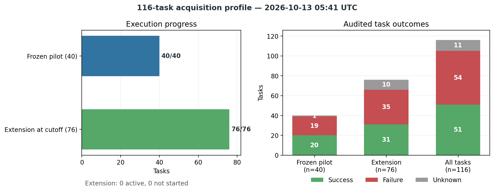
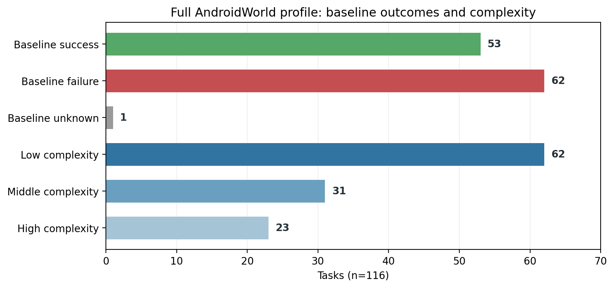
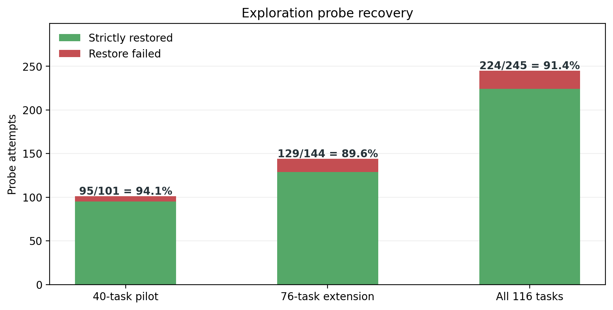
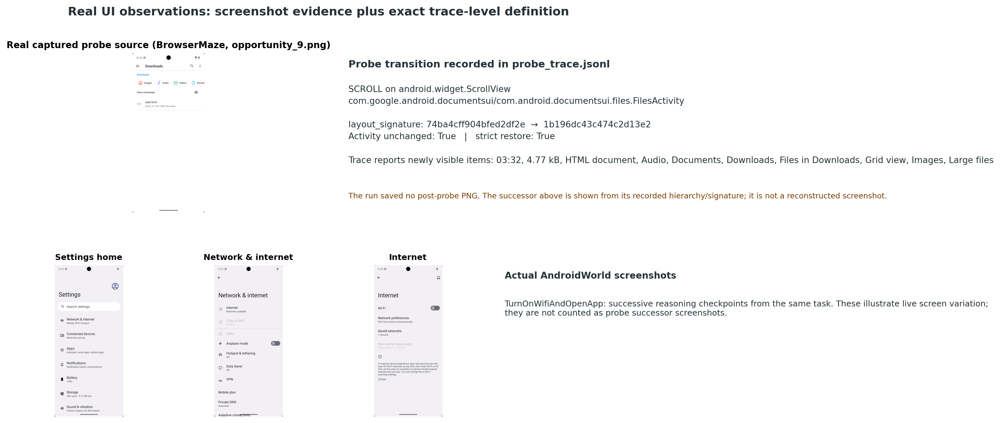
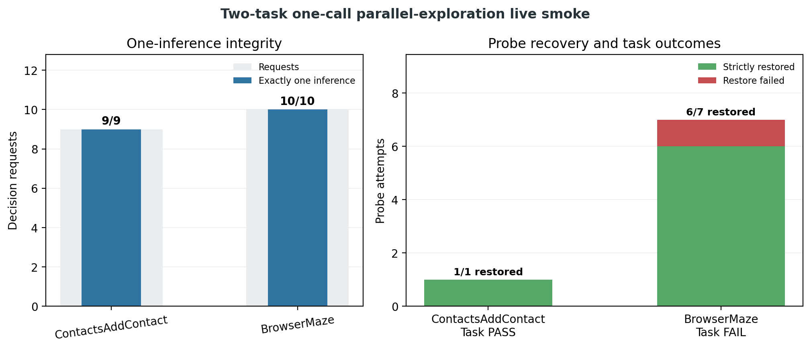
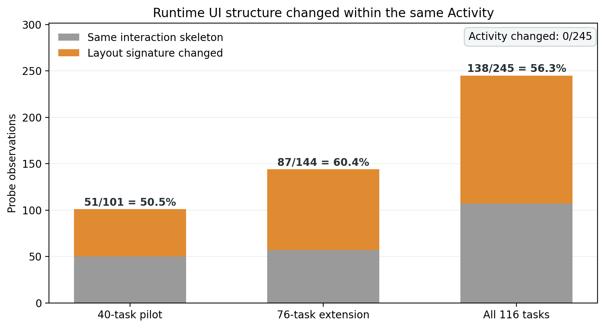
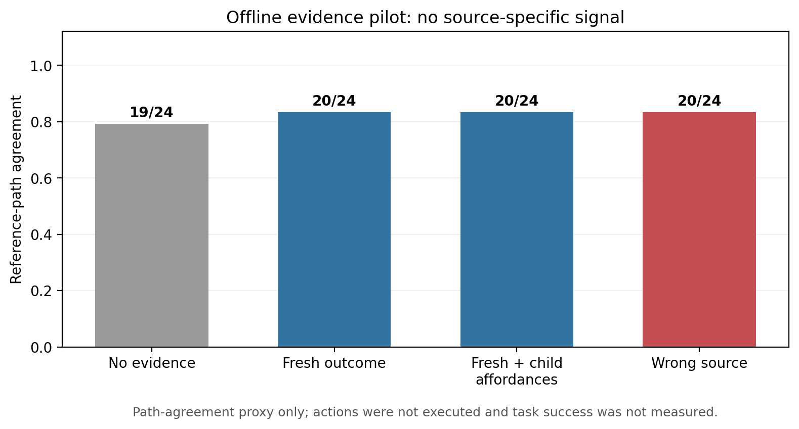
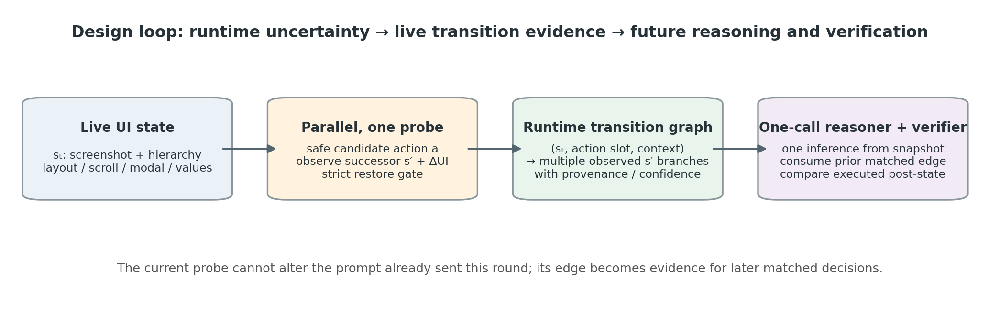
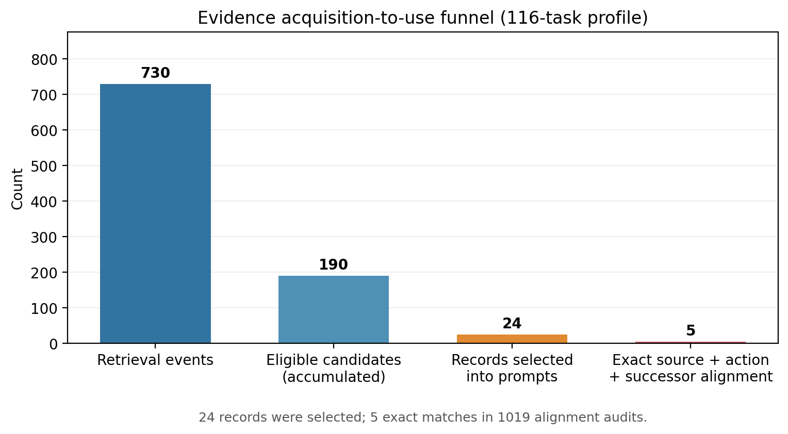

# MobileExplorer 阶段性实验进度与设计判断

**数据截点：2026-10-13 05:41 UTC（最后状态事件 2026-10-13T05:16:27+00:00）。** safety-v1 one-call acquisition profile 已覆盖 116/116 task；这是阶段性设计与效用报告，模型为 GELAB-ZERO-4B pilot，不是 MAI-UI 2B 主结果，也不是 reasoning efficacy 结论。

## 当前进度

| 队列 | 进度 | 实际决策请求 | probe / 严格恢复 / 失败 | task outcome（已审计） |
|---|---:|---:|---:|---:|
| Frozen 40-task pilot | 40/40 | 406，全部一次推理 | 101 / 95 / 6 | 20 success、19 failure、1 protocol unknown |
| 76-task 扩展 | 76/76 终态；0 active，0 未启动 | 623（623/623 实际请求各一次推理） | 144 / 129 / 15 | 31 success、35 failure、10 unknown（仅已终态） |
| 合计 | 116/116 有终态 | 1029 | 245 / 224 / 21 | 51 success、54 failure、11 unknown；不作增益结论 |

76-task 扩展使用冻结的 disjoint cohort、`CoverageRanker`、单次推理、并行 exploration/reasoning、最多每决策 probe 一次和严格恢复。两个批次合计覆盖完整 116-task registry。恢复失败时 stale action 被丢弃并安全等待；这一点保证安全，但也损失该轮 agent action。逐 probe trace 按代码内 `layout_signature` 重新审计后，pilot 为 51/101、扩展为 87/144，合计 138/245 次改变 interaction skeleton；**0 次改变 Android Activity**。前一版报告中的 23/101 缺少明确可复核的定义，现已更正为按统一签名重算的结果。

完整 116-task profile 覆盖 20 个 app；历史 baseline 为 53 success、62 failure、1 unknown，难度为 low/middle/high 62/31/23。扩展 cohort 的 10 个 unknown 中，8 个是 action protocol error、1 个是 evaluator protocol error、1 个是 initialization error，均不计为 task failure。

一句话结论：全量 116 个 task 已结束，正式 outcome 是 51 success、54 failure、11 unknown；它们描述该 4B pilot 的结果，不代表 exploration 的因果增益。

一句话结论：样本覆盖 53 个历史 baseline 成功、62 个失败和 1 个未知任务，并含 62/31/23 个 low/middle/high 难度任务。

一句话结论：245 次 probe 中 224 次严格恢复成功（91.4%），21 次失败仍是并行探索的主要运行风险。

一句话结论：真实 trace 中 BrowserMaze 的一次 ScrollView probe 在同一 `FilesActivity` 内产生了不同的 interaction skeleton；运行保存了源截图和后态 hierarchy/signature，但没有保存后态截图。

P0 的受控诊断 smoke 另有完整真实截图：Markor 的 To-Do tab probe 从 source 到 successor 保持同一 Activity，之后 authoritative replay 到达相同 successor；该图不是 116-task profile 的 probe 统计样本。

一句话结论：这张真实前后截图展示了“同一 Activity、不同 runtime UI、可复现的 action 后态”这一机制样例。

## 补充机制实验

一句话结论：3 个受控场景均通过 source 检查、证据检索、错误 source/action 拒绝、精确 successor replay 与 cleanup，且没有调用 VLM。

一句话结论：19/19 次决策请求都只做一次推理，8 次 probe 中 7 次严格恢复，但两任务的成功/失败与历史 baseline 一致，不能说明性能增益。

## 目前能回答什么

### Exploration 应该采集哪类信息？

目前最有根据的候选是 **当前 runtime source 下，一个语义 action slot 的真实后果**，不是泛化的页面摘要。本文将 UI structure change 操作性定义为：

`layout_signature(source) != layout_signature(probe successor)`，且两端 Activity 相同。

`layout_signature` 是交互骨架指纹：只用 actionable controls 的 class/resource-id；单例控件保留 64px 粗粒度位置，重复控件忽略位置；排除文本以及键盘/系统覆盖层。这样滚动列表中的项目数量/文本不改变“这是哪类页面”，而单例导航控件或布局位置变化仍可区分不同交互结构。相较之下，`structural_signature` 包含文本、selected 和 16px 量化 bounds，会对滚动和内容更新敏感；本报告单独审计它为 160/245 次变化，不把它等同于 UI structure change。

- source 的 Activity 加结构指纹/截图、滚动与弹窗等瞬时状态，以及关键可见值；
- action slot 的语义身份（resource-id 优先，其次唯一文本/描述/控件类型），并记录本次 hierarchy 中的实际 bounds；
- 点击/滚动后 successor 的结构差分、状态值变化、目标控件变化和系统条件；
- probe 是否恢复、后态是否由真实正式 action 重现，以及 observation 的时间、条件、来源和置信度。

实测证据支持“runtime 信息确实不同于 Activity”：138/245 次 probe 的 interaction skeleton 变化均发生在 Activity 未变时。但它**尚未证明哪些信息能提升 reasoning**。完整 116-task profile 有 730 次 evidence 检索、190 个累计 eligible 候选，24 条事实曾进入 prompt；可用的 1019 轮 action-slot 审计中，只有 5 轮实现 source/action/successor 精确匹配（40-task pilot: 2，76-task extension: 3）。所以 acquisition profile 显示当前主要瓶颈是“有效 transition evidence 很少到达可验证的 reasoning decision”，而不是 evidence 已经带来效果。

一句话结论：138/245 次 probe（56.3%）改变了 UI interaction skeleton，而 Activity 全程不变，说明 Activity 标签不足以识别 runtime UI。

### 现有 reasoning 对照说明了什么？

24-state 离线 pilot 的参考路径一致率为：无 evidence 19/24、新鲜 transition 20/24、新鲜 transition 加子页面 affordance 20/24、错误 source 对照 20/24。没有执行 action，也没有任务成功标签；wrong-source 与 fresh 相同，**所以现在不能声称 exploration evidence 改善 reasoning**，更不能声称 task success 提升。它指出了下一个实验的关键控制：fresh-source 必须优于 no-evidence，且不能被 wrong-source 复制。

一句话结论：fresh evidence 的路径一致率只比 no-evidence 高 1/24，且 wrong-source 达到相同结果，因此离线 pilot 没有提供 source-specific reasoning 增益证据。

## Graph 应该如何设计

把图的基本对象定为带 provenance 的**runtime transition multigraph**：

`runtime source + action slot + execution context → observed successor branch + UI delta`

同一个 source/action 保留多个 successor，不覆盖旧事实。source 要区分精确 runtime observation 和较粗的 state family；family 级匹配只作为迁移假设，不能冒充 exact evidence。边上存 probe/replay/authoritative 来源、恢复状态、时间、环境条件和复现次数。正式 action 执行后，verifier 根据 source、slot 和实际 successor 把边标成 known outcome、new branch、mismatch 或 unmatched。这个 verifier 验证的是转移预测，不等同于任务目标正确。

位置问题通过“当前 hierarchy hit-test → 语义 ActionSlot → 当下 bounds”处理，而不是复用旧坐标。当前 pilot 已用于 action-slot 匹配/验证；跨 screenshot 自动重新定位旧 slot 还需要单独实现和测量，不能当作已验证功能。

一句话设计结论：图应保存带 provenance 的多分支 runtime transition，explorer 并行采集新边，后续单次推理读取匹配边并由正式后态验证。

## 如何用 graph 来 exploration

探索目标应当是**任务无关的转移不确定性降低**，而非猜当前 task 要去哪一页。先用硬安全门筛选可逆且可严格恢复的候选，再按单位时间/恢复成本的 expected information gain 选 action：

`Score(a | s,D) = EIG(a | s,D) × P(strict restore | s,a) / (T_probe + T_restore + λ·risk)`

其中 `EIG = H[P(o | s,a,D)] − E_o[H[P(o | s,a,D ∪ {(s,a,o)})]]`，`o` 是观测到的 successor 与 UI delta。可先把结果抽象成新页面/弹窗、滚动或布局变化、关键值变化、无变化和 novel/unknown 等结果类型，同时保留原始 runtime fingerprint；用 Dirichlet-categorical posterior 估计各类分支的概率，再计算期望熵下降。安全门独立于信息价值：不可逆操作不因“信息量高”而放行。当前 `CoverageRanker` 是待比较的启发式 coverage baseline，不是 EIG，也不是最终设计。任务无关 selector 负责买到转移信息；fresh/none/wrong-source 的实际 action/evaluator replay 再判断这类信息是否帮助 reasoning。

保持每个决策恰好一次 VLM inference：reasoner 用决策起点截图与此前已提交的匹配边；model-free explorer 同时做 probe、记录 successor/delta 并严格恢复。本轮新边不能反向改写已经发出的 prompt。若正式 action 与 probe slot 相同，正式后态顺便验证这条边；否则边留给之后匹配 source 的一次推理使用。恢复失败就丢弃 stale action，fresh capture 后再做下一次正常单次推理。

一句话结论：24 条 evidence 进入 prompt，但在 1,019 次可审计决策中仅 5 次精确匹配 source、action 和 successor，当前主要瓶颈是证据到决策的匹配和可用性。

## 结论边界与下一步

现有结果可以支撑：**动态 UI 需要 runtime-scoped transitions；exploration 应验证 action slot 的后果，graph 同时承担 evidence store 与 transition verifier。** 现有结果不能支撑：这些信息已经改善 reasoning 或任务完成率。

下一步按这个顺序推进：

1. acquisition profile 已完成 116/116。先统一 task-level provenance、unknown 分类、decision log 与 transition observation，汇总 evidence exposure 和 source/action/successor 精确匹配率；协议 unknown 不算任务失败。
2. 从 profile 中找调用前已有 exact source/action evidence 的 checkpoint；每种条件独立 replay，同一个决策只做一次推理并执行 action。至少比较 fresh evidence / no evidence / wrong-source，固定 Explorer budget，报告 evidence exposure、action-slot 正确性、后态分支、官方 evaluator、恢复成本。
3. 只有当 fresh 在实际执行/任务指标上优于 no evidence，且 wrong-source 无同等效果，才能回答“哪些信息帮助 reasoning”。若 eligible checkpoint 少，先改进可用率，不要用离线路径一致性代替。
4. 用 append-only 多分支图与 EIG selector 对比当前 CoverageRanker/random，测每 probe 的不确定性下降、branch coverage、recoverability 与匹配决策收益；不要只看 node/edge 数。
5. 之后再复验 MAI-UI 2B；本报告所有 live 数据均为 4B pilot。

可用于 meeting 的一句话：**Exploration is a runtime experiment: it validates what a safe action slot actually does, records the resulting UI transition as source-conditioned evidence, and lets later one-call reasoning both use and verify that evidence.**

数据快照：[data_interim_progress_20261013.json](data_interim_progress_20261013.json)；生成脚本：[generate_interim_progress_report.py](../generate_interim_progress_report.py)。
