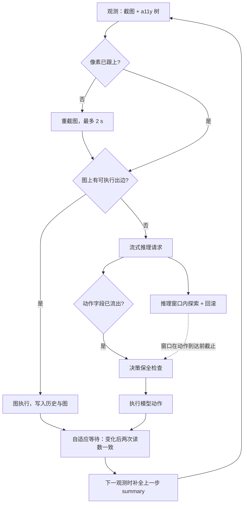

*MobileExplorer · FULL45 · 2026-10-23*

# MobileExplorer 设计 v45

在模型推理的同时，系统在设备上做带回滚的探索，把推理轨迹和探索轨迹写进同一张在线构建的页面图。下一步若能由图上一条已验证的出边完成，就由系统直接执行，省掉一次推理。同时在系统层把推理之外的时间压到最低：动作字段一流出就执行，界面一稳定就截图。

取代 `reports/mobileexplorer_design_v34_zh.md`（FULL33/34）。代码：`scripts/full_run.py`（arm FULL45）、`scripts/full9.py`。实验：`reports/e2e116n_final_zh.md`。

## 0 摘要

- **54 / 53**：成功数，FULL45 vs BASE（116 题）
- **−11.0%**：全部任务平均 e2e（151.9 → 135.2 s）
- **−21.1%**：共同成功 47 题 e2e（129.3 → 102.0 s）
- **−20.6%**：共同成功题推理次数（7.98 → 6.34）

三层设计，各自的收益可以分开归因：

- **图复用**（算法层）：减少推理次数。共同成功题上推理次数减少约 21%。
- **流式提前执行 + 自适应等待**（系统层，智能体侧）：每步非推理时间从约 3.3 s 降到约 0.5 s。10 题实测 e2e −16%。
- **n-gram 推测解码 + CUDA graph**（系统层，推理服务侧）：推理次数相同的题上 e2e −20%（BASE 182.8 → 146.0 s）。

全部在线完成：不使用离线同任务轨迹、离线函数库，也不用另一个 VLM 做探索。

## 1 问题与部署形态

### 目标

在成功率不下降的前提下，降低移动 GUI 智能体完成任务的端到端时延。端到端时延指从 episode 开始到结束的墙钟时间，包括推理、动作执行、等待界面稳定和截图。

### 时延构成（BASE，原推理服务配置）

- 推理占智能体时间的 85–90%：prefill 约 4.8 s，decode 约 10 tok/s，平均每次输出约 110 token。
- 输出格式为 `explain → action → summary`，THINK 约占一半的决策。动作字段比输出结束早约 3.8 s。
- 非推理时间每步约 3.3 s：固定等待 1 s、截图、a11y 树读取，以及等 summary 输出完。

### 实验部署

| 组件         | 配置                                                                                                                                   |
|--------------|----------------------------------------------------------------------------------------------------------------------------------------|
| 决策模型     | GELab-Zero-4B-preview，Jetson AGX Orin 上的 vLLM，开启 n-gram 推测解码（`num_speculative_tokens=8, prompt_lookup_max=6`）和 CUDA graph |
| 设备         | Android 模拟器（4 GB 内存），AndroidWorld 116 题，seed 30                                                                              |
| 端侧背景负载 | 模拟器内常驻 llama.cpp Qwen2-VL-2B（Q4_K_M，4 线程，`--cache-ram 0`）。每次决策期间发约 1700 token 的请求，模拟端侧模型占用 CPU 和内存 |
| 预算         | 每题最多 20 次模型推理，另设 40 个计数步的总上限（图执行也计步）                                                                       |

## 2 每步流水线

1.  **观测**：截图和 a11y 树。若 a11y 树显示页面已变而像素几乎未变，判为截图滞后，重新截图（FULL43）。
2.  **图复用**：检查当前页面是否有满足触发条件的出边（第 4 节）。有就执行、写入历史，不调用模型。
3.  **流式推理 ∥ 探索**：发出推理请求，同时在设备上探索（第 5 节）。探索窗口在动作通常到达前约 2 s 截止。
4.  **提前执行**：流式输出中出现 `summary:` 键，说明动作字段已完整，立即解析并执行，不等 summary 生成完。
5.  **决策保全**：如果探索改变了屏幕，按第 5.5 节决定直接执行、换位置执行或重新推理。
6.  **自适应等待**：界面变化后两次读数一致即截图；无变化时按该边学到的稳定时间等待（默认 0.6 s）。
7.  **补全历史**：上一步的 summary 先以占位写入历史，下一次观测时用流完的真实 summary 替换。

## 3 图

**节点**：页面，键为 (package, activity, layout 签名)。layout 级用于匹配和跨任务统计；struct + content 级用于验证到达页面和回滚是否成功。

**边**：(页面, 控件族) → 落地页面。控件族由 class、resource-id、content-desc、label 组成，不使用坐标。带 rid 的列表行按行族合并。

| 边元数据                      | 用途                                                  |
|-------------------------------|-------------------------------------------------------|
| 来源：agent / explore / graph | 区分模型示范、探索发现、图执行写回                    |
| 验证次数、误用次数            | 误用次数 ≥ max(1, 成功次数) 时停用该边                |
| 目的页截图与文本              | 探索打分时用目的页内容作为证据                        |
| 回滚方法与结果                | 可回滚概率 P_rev 的分层后验                           |
| 稳定时间 `FULL40`             | 自适应等待中“无变化”时的等待时长（最近 9 次的中位数） |

### 跨任务持久的安全事实

- `effectful.jsonl`：学到的会修改数据的控件，永不探索。FULL45 起，探索中观察到页面就地内容变化（`in_place_content_change`）的控件也写入这里。
- `unrestorable_groups.jsonl`：回滚失败的容器和列表同族。
- `d2_unsafe.jsonl`：第二跳不安全的边。

**构建**：本轮运行中逐步追加，跨任务持久，从空图开始。仍使用的离线信息只有统计量（TF-IDF 的 IDF 表、可回滚性的跨 app 角色先验），不含任何轨迹。

## 4 图复用

统一约定：前置条件成立 ∧ 图证据 ≥ 1 ∧ 能在实时屏幕上落地 ∧ 未被刹车。执行停在提交前，提交由模型完成。每次执行算一个计数步，并以 `[graph] ...` 写入模型的动作历史。

| 边类型                   | 含义                                         | 触发依据                                                                                      | v45 变化                                                                                                                                                                                                                                                         |
|--------------------------|----------------------------------------------|-----------------------------------------------------------------------------------------------|------------------------------------------------------------------------------------------------------------------------------------------------------------------------------------------------------------------------------------------------------------------|
| 启动 LAUNCH（bootstrap） | 桌面 → app 入口                              | 本轮图上观测到进入该 app 的转移                                                               | `FULL45` 指令在 app 名前要求系统动作（turn on/off、enable/disable、Wi-Fi、Bluetooth）时不跳过启动。逗号和 and 不算证据                                                                                                                                           |
| 确认 CONFIRM             | 提交对话框 → 确认                            | 模型刚亲自点了提交；同 app 同页面观测过确认转移                                               | `FULL45` 破坏性对话框（delete/remove/discard/erase/clear/reset/uninstall）第一次由模型决定，之后同一对话框（package, activity, 确认按钮文字）自动确认                                                                                                            |
| 参数化 PARAM（函数）     | 入口页 →\[导航/选值/输入\]\* → 提交前页面    | 本轮已完成、且模型自报完成的 episode 中抽取的过程（同模板留一）。槽位按字段角色对齐（FULL35） | 函数路由从同一 activity 的任意布局出发，可经过新建入口（FULL39）                                                                                                                                                                                                 |
| 模式 PATTERN（表单）     | 页面上带字段标签的空输入框，原地填入记录字段 | 页面结构：标签与记录字段匹配                                                                  | 表单路由（FULL38）：图上已知的编辑页若有 ≥2 个空字段能由当前记录填写，3 跳内沿安全边或新建入口走过去再代填。`FULL45` 选项字段：点匹配的选项；不可见时在横向选项条内部从 0.75w 滑到 0.25w（不从屏幕边缘起滑，避免触发系统返回手势）。还会向模型提示尚未填写的字段 |
| 动作 ACTION（导航宏）    | (页面, 控件族) → 页面                        | 本局重复出现的转移，或跨任务的边                                                              | `FULL45` 每个控件族每个 episode 最多走一次（FULL43 出现同一抽屉连点两次）                                                                                                                                                                                        |

> **授权原则（沿用）**：跨任务证据只用于导航和探索排序，不授权提交。提交只来自模型本人：模型刚点了提交，或同一对话框第一次已由模型确认过。FULL3 的结果显示，跨任务多数票有幸存者偏差：7 个“只有 BASE 成功”的任务全来自跨任务的 Calendar “New Event” 跳步。

> **已删除**：停靠 parking（FULL41–43）。思路是探索到目的页后不回滚，若模型决策正是该控件就直接停在目的页。40 题中仅命中 1 次、失配 2 次，FULL44 起关闭。

## 5 探索

### 5.1 时机与预算

- 只在推理窗口内进行，设备本来空闲，不额外占用 e2e 时间。
- 每个窗口最多 10 次探测（FULL41 起，原为 5），最长 30 s。
- 截止条件，满足任一即停：动作已流出（`decided`）；已到本轮流式决策“出动作时间”中位数之前 2 s（`deadline`，FULL42）。
- 上一次探测结果为“无变化”时，额外等 0.8 s：端侧负载下界面可能晚一点才显示效果。

### 5.2 不探索的状态与控件

- **临时状态**：弹窗、键盘、菜单、选择模式、抽屉、单窗口对话框。
- **学到的危险控件**：会修改数据的控件、回滚失败的容器。
- **危险词** `FULL44`：setting, search, edit, manage, go to, filter, sort, share, delete, remove, view, mode, today, account, sign, login。这类控件打开的是一种模式或一个新流程，不是一个页面。
- **一点就变状态的控件** `FULL45`：checkable、switch、checkbox、toggle、radiobutton，以及模型上一步刚操作过的控件族。

### 5.3 候选与打分

候选：当前页面上图中还没有 (页面, 控件族) 边的安全控件。新建入口（New / Add / +）在所有任务中都可探索（FULL38），它打开的编辑页会进入图，供后续任务的表单路由使用。FULL41 起，零相关的候选也会追加到队尾，用满探测预算。

    priority(c) = rel_TF-IDF(任务, 证据(c)) + λ·𝟙[相关性未知] − κ·(1 − P_rev(c))
    κ = 0.3,  λ = κ·(1 − 0.7)
    门槛：发现类 P_rev ≥ 0.8，复核类 ≥ 0.7

- **证据**：已知边的目的页内容 \> 同标签或同 rid 控件的目的页 \> 控件自身文本。
- **词权重**：三种 IDF 的几何平均（全局 app 级、图局部、任务局部）。
- **P_rev（分层贝叶斯）**：
  - 第 1 层：控件角色 × 屏幕区域的跨 app 先验；
  - 第 2 层：本 app 同类探索的后验（s0 = 10）；
  - 第 3 层：所在容器的证据（强度 5）。

  列表行和普通控件分开学习（FULL35）。

### 5.4 回滚

- **回滚阶梯**：返回 / 重选 → 沿联合图的安全路径恢复 → 重启 app 并重放本局动作 → 内容核对。
- **放宽的页面等价判定** `FULL42`：回到“足够相同”的页面即可，不要求逐字节一致。规则如下：
  - 标签一一匹配，位置偏差 ≤ 48 px；
  - 非可编辑控件允许后缀差异；
  - 忽略 snackbar、toast 和状态栏。

  以前的 90% Jaccard 判定太松，会把不同页面判成相同，已替换。
- **按返回后的等待** `FULL42`：等界面真正变化后再判定，不用固定时间。

### 5.5 决策保全

探索结束后，若屏幕和模型做决策时不同：差异不影响该决策时直接执行；被选控件只是位置变了时，在新位置执行；否则重新推理，记一次 requery。本轮 FULL45 全部 116 题共 11 次 requery。

## 6 系统层加速

| 机制                  | 做法                                                                                                                                        | 实测                                                                                                                             |
|-----------------------|---------------------------------------------------------------------------------------------------------------------------------------------|----------------------------------------------------------------------------------------------------------------------------------|
| 流式提前执行 `FULL41` | 流式解析输出，出现 `summary:` 键即执行动作。summary 先以占位（上一条 summary + 动作描述）写入历史，下一次观测时替换为真实 summary           | 每步省 2.4–2.85 s 非推理时间。10 题：BASE 201.7 s → BASE+流式 169.6 s（−16%），推理次数不变。FULL45 中 935 / 1062 次推理提前执行 |
| 自适应等待 `FULL40`   | 动作后轮询 a11y（0.15 s 间隔）：变化后连续两次读数一致即截图；不变化时等该边学到的稳定时间（默认 0.6 s，上限 3 s）。FULL41 起排除空白过渡帧 | 取代固定 1 s 等待                                                                                                                |
| 截图滞后补拍 `FULL43` | activity 或 layout 变了、但像素与上一帧几乎相同（下采样均值差 \< 3）时，每 0.25 s 重截，最多 2 s                                            | 修复了 RecipeAddSingleRecipe 中模型在旧帧上连点两次保存的问题。但阈值偏松，116 题触发 242 次（见第 9 节）                        |
| 推理服务 `部署`       | vLLM n-gram 推测解码（8 个推测 token，prompt lookup ≤ 6）+ CUDA graph（去掉 `--enforce-eager`）                                             | 离线基准 10.16 → 18.81 tok/s，单次决策 12.42 → 9.86 s。在线实测 decode 17.1–17.7 tok/s，首 token 延迟约 4.65 s                   |

## 7 结果（e2e116n，116 题全部配对）

| 口径           | BASE 成功 | 推理  | e2e     | FULL45 成功 | 推理 | e2e     | Δe2e   |
|----------------|-----------|-------|---------|-------------|------|---------|--------|
| 全部 116 题    | 53        | 10.14 | 151.9 s | 54          | 9.16 | 135.2 s | −11.0% |
| 成功任务       | 53        | 8.06  | 130.2 s | 54          | 6.69 | 107.7 s | −17.3% |
| 共同成功（47） | 47        | 7.98  | 129.3 s | 47          | 6.34 | 102.0 s | −21.1% |

### 与上一轮（原推理服务，FULL44）对比

| 配置                        | 成功 | 推理  | e2e     | e2e / 推理 |
|-----------------------------|------|-------|---------|------------|
| BASE，原推理服务            | 51   | 10.48 | 194.5 s | 18.55 s    |
| BASE，n-gram + CUDA graph   | 53   | 10.14 | 151.9 s | 14.98 s    |
| FULL44，原推理服务          | 49   | 9.04  | 163.2 s | 18.05 s    |
| FULL45，n-gram + CUDA graph | 54   | 9.16  | 135.2 s | 14.76 s    |

### 机制计数（FULL45）

推理 1062 次，其中提前执行 935 次。图执行方面：函数步 87，表单字段 67，表单选项 4，导航宏 2，跳步提交 13，跳过 app 启动 76 次。探索 163 次，requery 11 次，截图补拍 242 次。

### 结果不一致的任务（13 题）

- **FULL45 赢 7 题**：ExpenseAddMultiple（推理 20 → 7，选项选择生效）、RecipeAddMultipleRecipes、SimpleDrawProCreateDrawing、OsmAndFavorite、AudioRecorderRecordAudio、ClockStopWatchPausedVerify、SimpleCalendarAnyEventsOnDate。
- **FULL45 输 6 题**：
  - SystemBluetoothTurnOff：探索回滚失败；
  - TurnOffWifiAndTurnOnBluetooth：探索回滚失败，之后在同一开关上连点 6 次；
  - 其余 4 题：两道问答题答错（推理次数相同），以及 RetroCreatePlaylist、AudioRecorderRecordAudioWithFileName。

> 单轮成功率差 ±1 题，处在同配置的波动范围内（±4 题），不宣称提升成功率。可以宣称的是：同等成功率下，共同成功题的 e2e −21%、推理 −21%，且每一部分节省都能按机制归因。

## 8 已排除的方案（有实测依据）

| 方案                                       | 结论     | 依据                                                                                                                                                                  |
|--------------------------------------------|----------|-----------------------------------------------------------------------------------------------------------------------------------------------------------------------|
| 按状态跳过 THINK                           | `不采用` | THINK 步上预填 `action:`，与原决策一致率 110 → 95 / 122。限 40 token 时一致率 100 / 122；限 80 token 时 111 / 122，但几乎不省时间。图状态也无法识别哪些步可以安全跳过 |
| 用图中存的截图推测下一次推理               | `不采用` | 与真实决策的一致率 87% → 66%，损失来自截图本身，与缺 summary 无关                                                                                                     |
| 流水线化 summary（下一次推理不等 summary） | `待重测` | 以 explain 作占位时，与现流水线结果相同的比例为 79%；对原始动作 113 vs 117。需要更好的占位后重测                                                                      |
| 停靠 parking                               | `已删除` | 命中 1 次，失配 2 次                                                                                                                                                  |
| 图或子页面信息写进 prompt                  | `不采用` | 6 种形式 + 安慰剂对照均无净收益；模型服从文字提示，但图提示约 50% 正确，模型自身约 90%                                                                                |
| 深度 2 探索                                | `不采用` | 第二跳回滚失败 40%                                                                                                                                                    |
| 跨任务证据授权执行或提交                   | `不采用` | 幸存者偏差（见第 4 节）                                                                                                                                               |

## 9 已知问题与 FULL46 修改建议

| \#  | 问题                              | 证据                                                                                                                                                                       | 建议修改                                                                                                                            |
|-----|-----------------------------------|----------------------------------------------------------------------------------------------------------------------------------------------------------------------------|-------------------------------------------------------------------------------------------------------------------------------------|
| 1   | 探索点到“内含开关的整行”          | SystemBluetoothTurnOffVerify：探索点了 Bluetooth 整行（LinearLayout），页面就地变化，回滚失败，多花 4 次推理。TurnOffWifiAndTurnOnBluetooth 的 Connection preferences 同类 | `_risky_slot` 检查子孙节点：任一子孙是 checkable 或 switch，整行即视为危险。或者设置类 activity（`com.android.settings`）一律不探索 |
| 2   | 系统设置页回滚失败后模型被困      | SystemBluetoothTurnOff：进入 Network & internet 后返回失败，图恢复被判为不安全跳转，模型连滑 8 次                                                                          | 回滚失败且图恢复被拒时，直接重启 app 并重放本局动作（阶梯第 3 级），不把错误页面交给模型                                            |
| 3   | 截图补拍阈值太松                  | 242 次触发；单题最多 15 次。开关连点疑似仍看到旧帧                                                                                                                         | 均值差阈值从 3 收紧到 0.5，或只比较被操作控件附近的区域；开关类动作后额外校验 a11y 中的 `checked` 状态                              |
| 4   | 打开 app 失败会让 episode 崩溃    | 模型输出中文 app 名「剪贴板」，`adb monkey` 抛异常                                                                                                                         | 捕获异常，作为一次无效动作反馈给模型（BASE 同样受益）                                                                               |
| 5   | 流式 summary 偶尔写成 action 字典 | SystemWifiTurnOffVerify 第 1 步的历史 summary 是一个 dict                                                                                                                  | `_resolve_pending` 只接受字符串，解析失败时退回占位文字                                                                             |
| 6   | System 类探索收益为负             | System 13 题：成功 11 → 10，推理 6.0 → 6.4                                                                                                                                 | 与 \#1 一起处理；或按 app 的回滚失败后验自动关闭探索                                                                                |

### 继续降低 e2e 的方向

- **流水线化 summary**：用“上一条 summary + 动作描述”作占位，离线重测一致率；达标后让下一次推理不等 summary 流完。
- **表单整串输入**：图代填时一次性写入整段文本，不逐字输入。
- **跨 app 流程模板**：需要先做离线评估，注意幸存者偏差。

建议先在 System + Turn 的 15 题上验证 \#1–#3，再跑 116 题全量。

## 10 参数表

| 参数                                     | 值                 | 位置                                       |
|------------------------------------------|--------------------|--------------------------------------------|
| 每窗口最多探测数                         | 10                 | `PROBES_PER_STEP`                          |
| 探索窗口上限                             | 30 s               | `ExploreCfg.budget_s`                      |
| 窗口截止提前量                           | 2.0 s              | 本轮最近 15 次决策出动作时间的中位数 − 2 s |
| κ / 发现类门槛 / 复核类门槛              | 0.3 / 0.8 / 0.7    | `KAPPA, P_REV_MIN_RV`                      |
| 自适应等待默认 / 上限 / 轮询间隔         | 0.6 / 3.0 / 0.15 s | `EDGE_WAIT_DEFAULT, EDGE_WAIT_MAX, POLL`   |
| 截图补拍阈值 / 上限                      | 均值差 3 / 2 s     | `_pixels_caught_up`                        |
| 页面等价的位置容差                       | 48 px              | `_same_state_relaxed`                      |
| 推理预算 / 计数步上限                    | 20 / 40            | FULL37 起                                  |
| n-gram 推测 token / prompt lookup 最大值 | 8 / 6              | Orin `start_ngram8_graph.sh`               |
